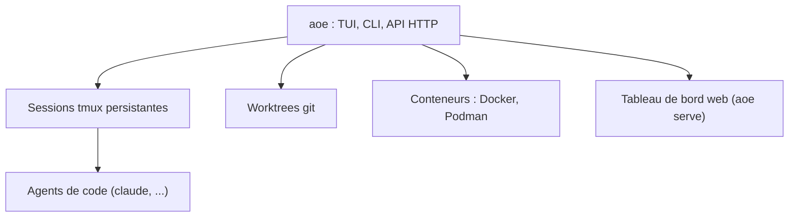

# njbrake/agent-of-empires

> Gestionnaire de sessions tmux pour agents de code en parallèle, avec worktrees git et conteneurs.

## Le problème
Lancer plusieurs agents de code sur des branches différentes devient vite ingérable : sessions perdues à la fermeture du terminal, conflits entre branches.

## Ce que ça fait vraiment
Chaque agent tourne dans sa propre session tmux persistante. L'outil ajoute la détection d'état, des notifications, la gestion de worktrees git et d'espaces multi-dépôts, l'isolation par Docker, Podman ou Apple Containers, un tableau de bord web (accès mobile) et un visualiseur de diffs. Surfaces : TUI, web, CLI, API HTTP.

## Comment c'est branché
Schéma simplifié d'après la fiche, sans diagramme fourni.



## Essayer
```bash
brew install aoe
aoe
aoe add --cmd claude
aoe serve
```
Alternative : le script `scripts/install.sh` du dépôt.

## Coût et pièges
Gratuit. Exige tmux (Linux ou macOS) ; Windows seulement via WSL2. Docker est optionnel, pour l'isolation. Les agents eux-mêmes ont leur propre coût.

## Ce que ce n'est pas
Pas un agent : il pilote des agents existants. Ce n'est pas un simple tmux, mais tu peux toujours t'attacher à une session avec `tmux attach`.

## Alternatives
- Aucune alternative nommée dans le README.

## Pour toi
À adopter pour essai si tu fais tourner plusieurs agents de code : sessions persistantes et worktrees évitent de perdre du travail, sans compte ni clé requis.

