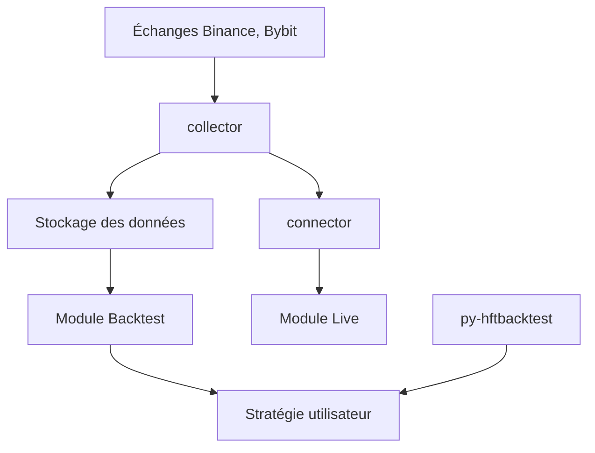

# nkaz001/hftbacktest

> High-frequency backtesting library that simulates latencies and order queue position, for market-making strategies.

## The problem
Classic backtests ignore latency and position in the order book, and therefore over- or underestimate gains.

## What it actually does
Tick-by-tick simulation with full order book reconstruction (levels 2 and 3), feed and order latency models, fills based on queue position, and multi-asset and multi-market support. Strategies are written in Python compiled by Numba, or in Rust. A live mode (Binance Futures, Bybit) reuses the same code, in Rust only.

## How it is wired


## Trying it
```bash
pip install hftbacktest
git clone https://github.com/nkaz001/hftbacktest
```

## Cost and gotchas
Free (MIT), Python 3.11 or later. You need tick-by-tick market data, sometimes paid; the README points to data preparation. Last push in December 2025.

## What it is not
Not a turnkey trading tool: it provides neither a profitable strategy nor any guarantee of real-world results. Live mode exists only in Rust.

## Alternatives
No alternative cited in the README.

## For you
Adopt if you do quantitative research: a rare simulator that models latency and queue position, with a fast Python API; keep the single maintainer in mind.
