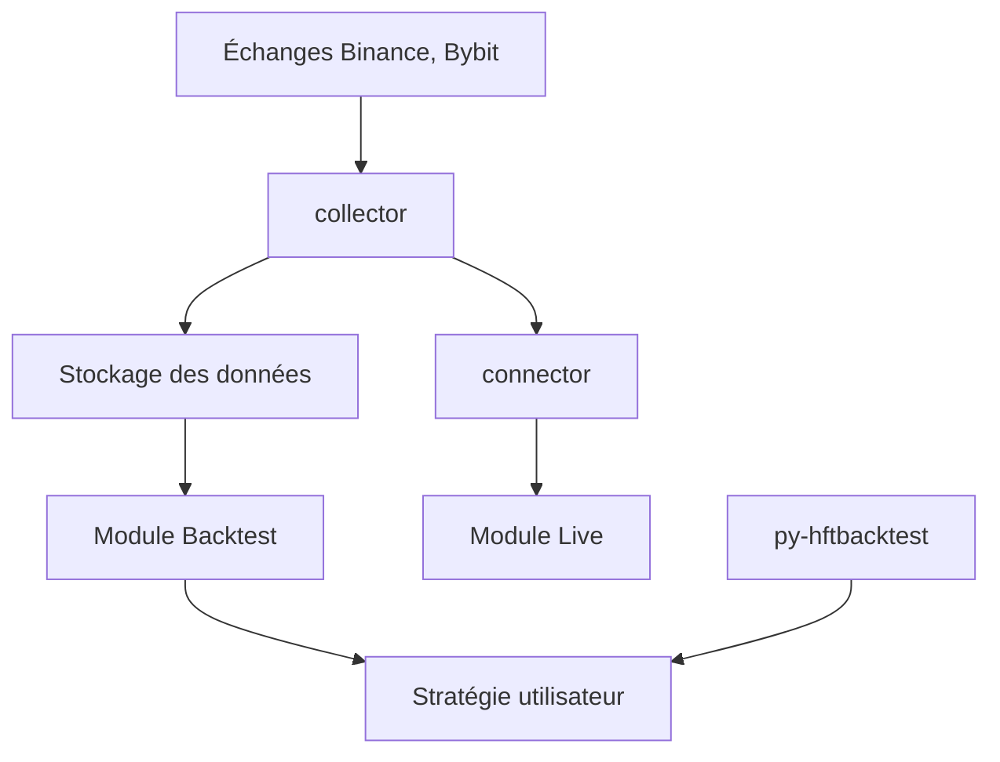

# nkaz001/hftbacktest

> Bibliothèque de backtest haute fréquence qui simule latences et file d'attente des ordres, pour stratégies de market making.

## Le problème
Les backtests classiques ignorent la latence et la position dans le carnet d'ordres, donc surestiment ou sous-estiment les gains.

## Ce que ça fait vraiment
Simulation tick par tick avec reconstruction du carnet complet (niveaux 2 et 3), modèles de latence de flux et d'ordres, remplissage selon la position dans la file, et multi-actifs et multi-marchés. Les stratégies s'écrivent en Python compilé par Numba, ou en Rust. Un mode live (Binance Futures, Bybit) réutilise le même code, en Rust seulement.

## Comment c'est branché


## Essayer
```bash
pip install hftbacktest
git clone https://github.com/nkaz001/hftbacktest
```

## Coût et pièges
Gratuit (MIT), Python 3.11 ou plus. Il faut des données de marché tick par tick, parfois payantes ; le README renvoie à la préparation de données. Dernier push en décembre 2025.

## Ce que ce n'est pas
Pas un outil clé en main de trading : il ne fournit ni stratégie rentable ni garantie de résultats réels. Le mode live n'existe qu'en Rust.

## Alternatives
Aucune alternative citée dans le README.

## Pour toi
À adopter si tu fais de la recherche quantitative : rare simulateur qui modélise latence et file d'attente, avec API Python rapide ; mainteneur unique à garder en tête.

