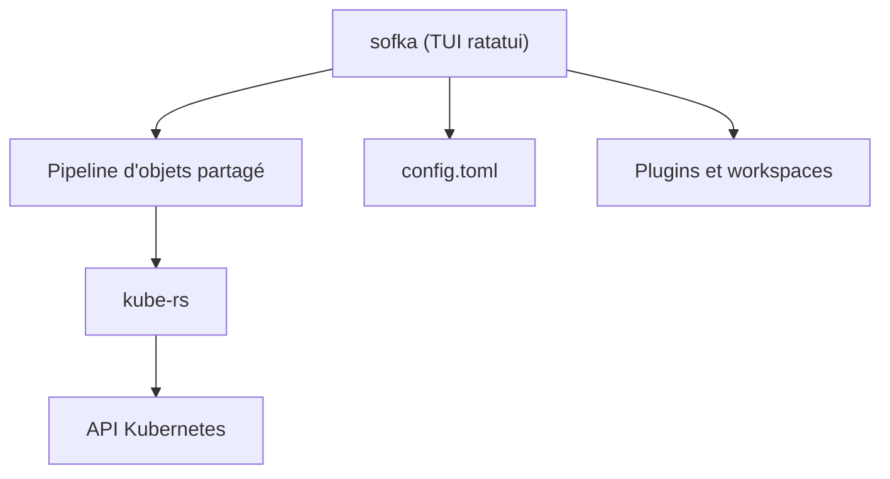

# nklmilojevic/sofka

> Kubernetes terminal interface in Rust, inspired by k9s, for cluster operators.

## The problem
Browsing a cluster with `kubectl` means running many commands, and Flux or Argo CD actions force you to install other binaries.

## What it actually does
A TUI (kube-rs and ratatui) that lists native resources and CRDs with a single display pipeline. It suspends, resumes and syncs Flux and Argo CD through API patches, with no external binary. The `X` key opens a deterministic incident view, with no AI. It offers bulk actions, background port-forwards, per-context read-only mode and themes.

## How it is wired
Simplified diagram based on the sheet, no diagram provided.



## Trying it
```bash
brew install nklmilojevic/sofka/sofka
cargo install sofka
sofka --check
sofka pods --snapshot
```

## Cost and gotchas
Free, but you need a valid kubeconfig. The macOS binaries are neither signed nor notarized: you have to remove the quarantine attribute.

## What it is not
It is not a proven replacement for k9s: the project dates from July 2026. It is not a graphical tool nor an AI tool.

## Alternatives
- k9s: the model sofka draws from, older and more widespread.

## For you
Worth watching: interesting for driving an MLOps cluster with Flux or Argo CD from the keyboard, but the project is young.
