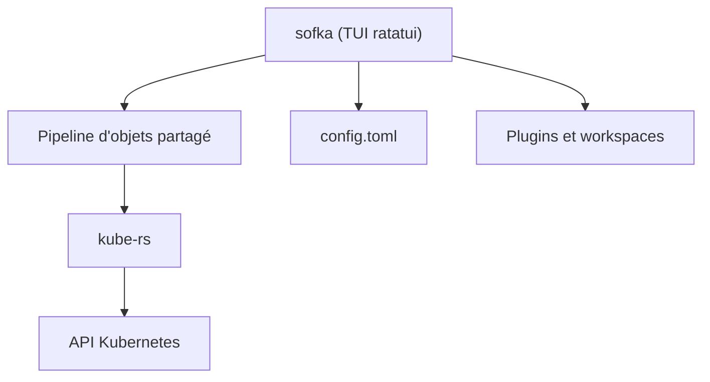

# nklmilojevic/sofka

> Interface terminale Kubernetes en Rust, inspirée de k9s, pour opérateurs de clusters.

## Le problème
Parcourir un cluster avec `kubectl` demande de multiplier les commandes, et les actions Flux ou Argo CD obligent à installer d'autres binaires.

## Ce que ça fait vraiment
Une TUI (kube-rs et ratatui) qui liste ressources natives et CRD avec un seul pipeline d'affichage. Elle suspend, reprend et synchronise Flux et Argo CD par patchs API sans binaire externe. La touche `X` ouvre une vue d'incident déterministe, sans IA. Elle propose actions groupées, port-forwards en arrière-plan, mode lecture seule par contexte et thèmes.

## Comment c'est branché
Schéma simplifié d'après la fiche, sans diagramme fourni.



## Essayer
```bash
brew install nklmilojevic/sofka/sofka
cargo install sofka
sofka --check
sofka pods --snapshot
```

## Coût et pièges
Gratuit, mais il faut un kubeconfig valide. Les binaires macOS ne sont ni signés ni notarisés : il faut retirer l'attribut de quarantaine.

## Ce que ce n'est pas
Ce n'est pas un remplaçant prouvé de k9s : le projet date de juillet 2026. Ce n'est pas un outil graphique ni un outil d'IA.

## Alternatives
- k9s : modèle dont sofka s'inspire, plus ancien et plus répandu.

## Pour toi
À surveiller : intéressant pour piloter un cluster MLOps avec Flux ou Argo CD au clavier, mais le projet est jeune.

