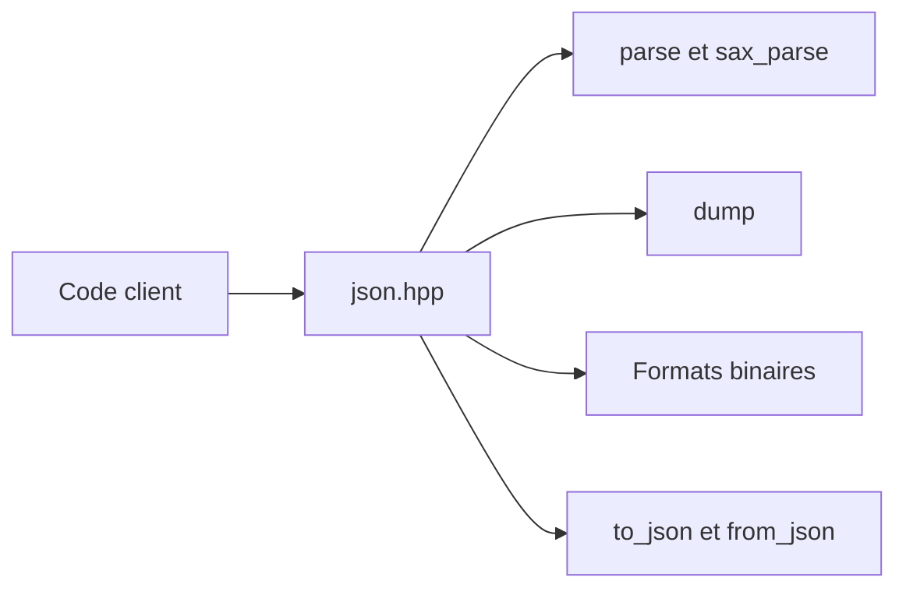

# nlohmann/json

> A single C++ header library for reading, writing, and manipulating JSON data with a syntax similar to Python.

## The problem
Working with JSON in C++ using verbose APIs slows down development and requires a complex integration process.

## What it actually does
A C++11 `json.hpp` file without dependencies. The `json` type behaves like an STL container. It supports parsing, serialization, JSON Pointer, JSON Patch, Merge Patch, and custom type conversions using macros, as well as binary formats (BSON, CBOR, MessagePack, UBJSON, BJData, BON8). It also offers views without copying, with a separate header. It includes 100% code coverage testing and OSS-Fuzz fuzzing.

## How it is wired


## Trying it
```bash
mkdir build
cd build
cmake .. -DJSON_BuildTests=On
cmake --build .
ctest --output-on-failure
```

## Cost and gotchas
Free. Only UTF-8 is supported; the `dump()` function may raise an exception if non-UTF-8 data is provided. The order of keys is not preserved (except for `ordered_json`). No default comments are included. The README indicates that speed is not a priority.

## What it is not
According to its own README, it is not the fastest JSON library.

## Alternatives
No alternative is specified in the README.

## For you
Ignore this unless you are writing in C++: In Python, the standard JSON format is sufficient; if you use it, it remains the safest option.
