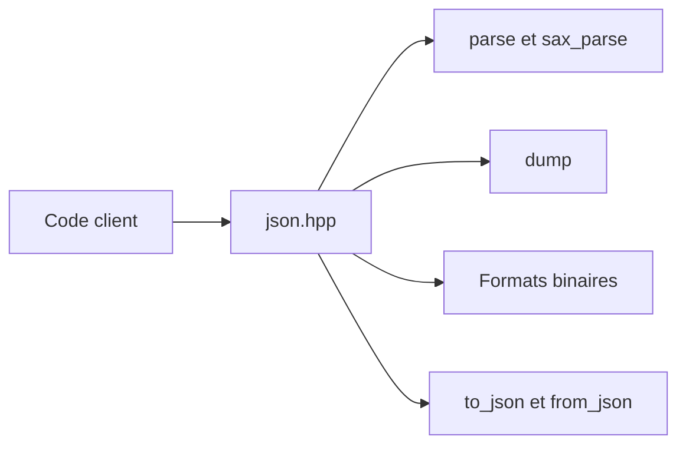

# nlohmann/json

> Bibliothèque C++ d'un seul en-tête pour lire, écrire et manipuler du JSON avec une syntaxe proche de Python.

## Le problème
Manipuler du JSON en C++ avec des API verbeuses ralentit le développement et oblige à une intégration lourde.

## Ce que ça fait vraiment
Un fichier `json.hpp` en C++11 sans dépendance. Le type `json` se comporte comme un conteneur STL. Parse, sérialise, JSON Pointer, JSON Patch, Merge Patch, conversions de types personnalisés par macros, formats binaires (BSON, CBOR, MessagePack, UBJSON, BJData, BON8). Vues sans copie en en-tête séparé. Tests à 100 % de couverture et fuzzing OSS-Fuzz.

## Comment c'est branché


## Essayer
```bash
mkdir build
cd build
cmake .. -DJSON_BuildTests=On
cmake --build .
ctest --output-on-failure
```

## Coût et pièges
Gratuit. UTF-8 seulement ; `dump()` peut lever une exception sur du non-UTF-8. L'ordre des clés n'est pas conservé (`ordered_json` à part). Pas de commentaires par défaut. Le README annonce ne pas viser la vitesse.

## Ce que ce n'est pas
Pas la bibliothèque JSON la plus rapide, d'après le README lui-même.

## Alternatives
Aucune alternative nommée dans le README.

## Pour toi
À ignorer sauf si tu écris du C++ : en Python, le JSON standard suffit ; si tu en fais, elle reste la valeur sûre.

