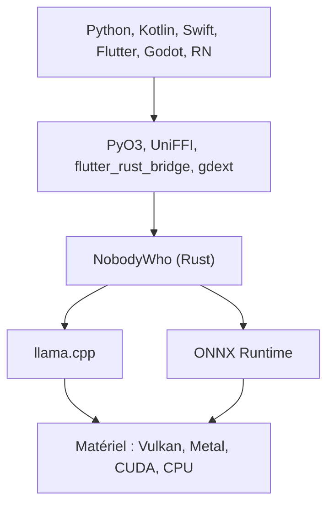

# nobodywho-ooo/nobodywho

> Local LLM inference engine, with bindings for Python, mobile and Godot, for app developers.

## The problem
Embedding an LLM in a mobile app or a game means grafting llama.cpp by hand into each language.

## What it actually does
A Rust core handles chat, templates, grammars, sampling and context shifting. It relies on llama.cpp for text, vision, embeddings and reranking, and on ONNX Runtime for speech and voice detection. Bindings cover Python, Kotlin, Swift, React Native, Flutter and Godot. Tool calling generates grammars from function signatures.

## How it is wired


## Trying it
```bash
pip install nobodywho
```
```python
from nobodywho import Chat
chat = Chat('hf:NobodyWho/Qwen_Qwen3-0.6B-GGUF:Q4_K_M')
print(chat.ask('What is the capital of Denmark?').completed())
```

## Cost and gotchas
Free, offline. Plan for about 1.5 times the model size in free RAM. No Windows ARM64, no web export, no iOS for Godot. EUPL-1.2 license, copyleft.

## What it is not
Not a hosted service nor a model trainer: it runs GGUF models. The OpenAI-compatible server is experimental.

## Alternatives
- No alternative named in the README, other than llama.cpp on which it is built.

## For you
Worth watching: handy for embedded inference on mobile, but the EUPL needs checking before any commercial use.
