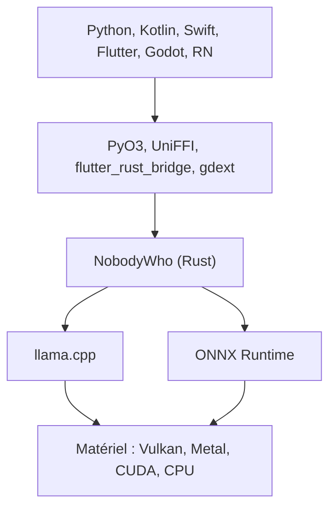

# nobodywho-ooo/nobodywho

> Moteur d'inférence local de LLM, avec liaisons pour Python, mobile et Godot, pour développeurs d'applis.

## Le problème
Embarquer un LLM dans une appli mobile ou un jeu oblige à greffer llama.cpp à la main dans chaque langage.

## Ce que ça fait vraiment
Un cœur en Rust gère chat, gabarits, grammaires, échantillonnage et décalage de contexte. Il s'appuie sur llama.cpp pour texte, vision, embeddings et reranking, et sur ONNX Runtime pour la parole et la détection de voix. Les liaisons couvrent Python, Kotlin, Swift, React Native, Flutter et Godot. L'appel d'outils génère les grammaires depuis les signatures de fonctions.

## Comment c'est branché


## Essayer
```bash
pip install nobodywho
```
```python
from nobodywho import Chat
chat = Chat('hf:NobodyWho/Qwen_Qwen3-0.6B-GGUF:Q4_K_M')
print(chat.ask('What is the capital of Denmark?').completed())
```

## Coût et pièges
Gratuit, hors ligne. Compter environ 1,5 fois la taille du modèle en RAM libre. Pas de Windows ARM64, pas d'export web, pas d'iOS pour Godot. Licence EUPL-1.2, à copyleft.

## Ce que ce n'est pas
Pas un service hébergé ni un entraîneur de modèles : il exécute des modèles GGUF. Le serveur compatible OpenAI est expérimental.

## Alternatives
- Aucune alternative nommée dans le README, hormis llama.cpp sur lequel il repose.

## Pour toi
À surveiller : pratique pour de l'inférence embarquée sur mobile, mais l'EUPL demande une vérification avant tout usage commercial.

