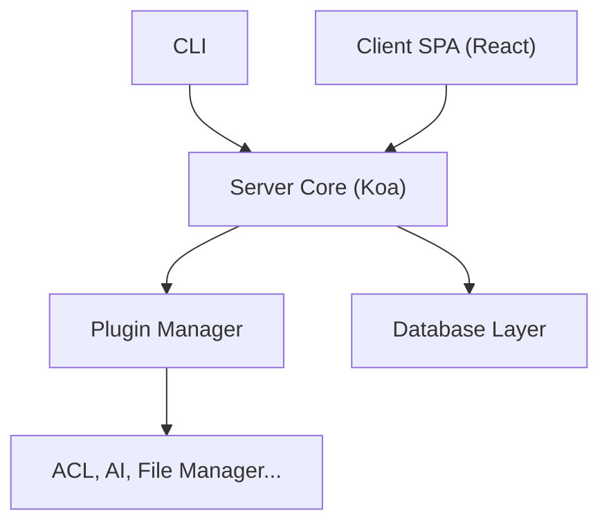

# nocobase/nocobase

> Open source platform to build business systems with AI agents on a common foundation.

## The problem
Every project reinvents permissions, workflows and validations, and AI-generated code drifts from one session to the next.

## What it actually does
A foundation (NocoBase Core) with permissions, workflows, files; Studio to coordinate Claude Code, Codex and OpenCode; Solutions, business applications driven by agents. Monorepo architecture: Koa server, React client, plugin manager, multi-source data layer.

## How it is wired


## Trying it
```bash
npx skills@latest add nocobase/skills-v3 --skill nocobase-create-app -g
PNPM_CONFIG_MINIMUM_RELEASE_AGE=0 pnpm create @nocobase/app@beta my-app --template-tag=beta
pnpm nocobase config init --dialect sqlite
pnpm dev
```

## Cost and gotchas
Node 24 or later and pnpm 11; WSL on Windows. Examples use SQLite, with no database server. Version 3 in beta. No license declared in the catalog: usage rights not established.

## What it is not
Not a data/ML framework. Studio and Solution are separate products, their availability is not detailed.

## Alternatives
None named in the README.

## For you
Watch: interesting for agent-driven back-office, but the lack of a license and the beta version hold back adoption.
