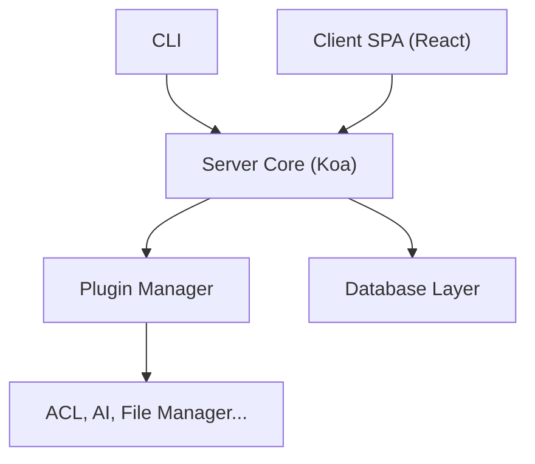

# nocobase/nocobase

> Plateforme open source pour construire des systèmes métier avec des agents IA sur un socle commun.

## Le problème
Chaque projet réinvente permissions, workflows et validations, et le code généré par IA dérive d'une session à l'autre.

## Ce que ça fait vraiment
Socle (NocoBase Core) avec permissions, workflows, fichiers ; Studio pour coordonner Claude Code, Codex et OpenCode ; Solutions, applications métier pilotées par agents. Architecture monorepo : serveur Koa, client React, gestionnaire de plugins, couche de données multi-sources.

## Comment c'est branché


## Essayer
```bash
npx skills@latest add nocobase/skills-v3 --skill nocobase-create-app -g
PNPM_CONFIG_MINIMUM_RELEASE_AGE=0 pnpm create @nocobase/app@beta my-app --template-tag=beta
pnpm nocobase config init --dialect sqlite
pnpm dev
```

## Coût et pièges
Node 24 ou plus et pnpm 11 ; WSL sous Windows. Exemples en SQLite, sans serveur de base. Version 3 en bêta. Aucune licence déclarée au catalogue : droits d'usage non établis.

## Ce que ce n'est pas
Pas un framework data/ML. Studio et Solution sont des produits distincts, leur disponibilité n'est pas détaillée.

## Alternatives
Aucune nommée dans le README.

## Pour toi
À surveiller : intéressant pour du back-office piloté par agents, mais l'absence de licence et la version bêta freinent l'adoption.

