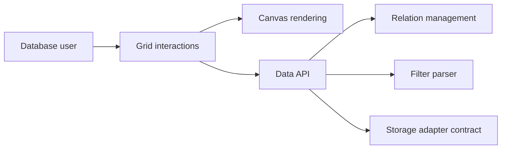

# nocodb/nocodb

> No-code spreadsheet interface above databases, self-hosted, with REST API.

## The problem
Spreadsheets are easy to use but have limitations; databases are powerful but inaccessible to non-developers.

## What it actually does
Display tables and rows in a grid with filters, sorting, grouping, and views (grid, gallery, form, Kanban, calendar). Cell types (links, lookup, rollup, formula), view sharing with password, roles. Programmatic access via REST and SDK; integrations with chat, email, and storage.

## How it is wired


## Trying it
```bash
docker run -d --name noco -v "$(pwd)"/nocodb:/usr/app/data/ -p 8080:8080 nocodb/nocodb:latest
```

## Cost and gotchas
Free to host. The self-installation script (`curl | bash`) installs Docker, PostgreSQL, Redis, and Traefik. The example with PostgreSQL includes a fake JWT secret that needs to be replaced. The binaries are intended for local testing only.

## What it is not
Not a database in itself: it overlays on an existing database or SQLite. The license is not identified by GitHub.

## Alternatives
No alternative is specified in the README file.

## For you
Things to watch out for: a tool for creating spreadsheet-like interfaces for data, but with a license that needs to be checked before use in a business setting.
