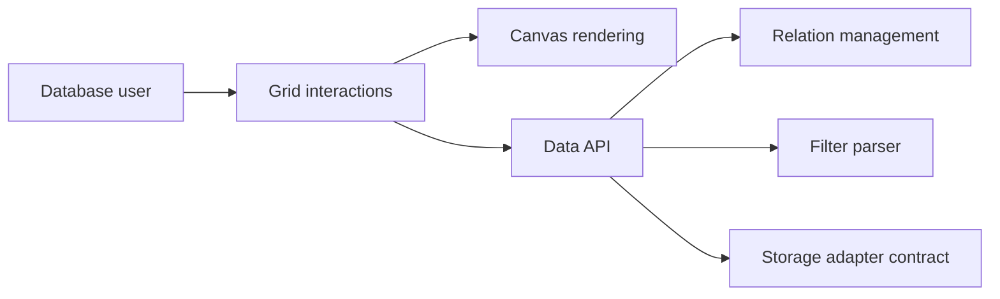

# nocodb/nocodb

> Interface tableur no-code au-dessus de bases de données, auto-hébergeable, avec API REST.

## Le problème
Les tableurs sont faciles mais limités ; les bases de données sont puissantes mais inaccessibles aux non-développeurs.

## Ce que ça fait vraiment
Affiche tables et lignes dans une grille avec filtres, tris, regroupements et vues (grille, galerie, formulaire, kanban, calendrier). Types de cellules (liens, lookup, rollup, formule), partage de vues avec mot de passe, rôles. Accès programmatique par REST et SDK ; intégrations de chat, e-mail et stockage.

## Comment c'est branché


## Essayer
```bash
docker run -d --name noco -v "$(pwd)"/nocodb:/usr/app/data/ -p 8080:8080 nocodb/nocodb:latest
```

## Coût et pièges
Gratuit à héberger. Le script d'auto-installation (`curl | bash`) installe Docker, PostgreSQL, Redis et Traefik. L'exemple avec PostgreSQL contient un secret JWT factice à remplacer. Les binaires sont réservés aux tests locaux.

## Ce que ce n'est pas
Pas une base de données : il se superpose à une base existante ou à SQLite. La licence n'est pas identifiée par GitHub.

## Alternatives
Aucune alternative nommée dans le README.

## Pour toi
À surveiller : pratique pour donner une interface tableur à des données, avec licence à vérifier avant usage en entreprise.

