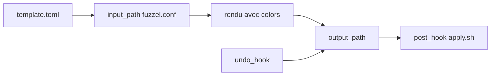

# noctalia-dev/community-templates

> Community theme templates that apply Noctalia's colors to Linux application configurations.

## The problem
Each Linux application has its own theme format; keeping colors consistent with the shell requires one file per application.

## What it actually does
One folder per application contains a `template.toml`, the config file using Noctalia's template syntax, and an optional `apply.sh`. Noctalia renders the template with the current palette, writes it into the application's config and runs a hook. The repository mainly serves as a contribution guide: one application per PR, a README and a screenshot.

## How it is wired
Simplified diagram based on the sheet, no diagram provided.



## Trying it
```bash
noctalia theme --list-templates
```
Testing goes through a "user template" declared in `~/.config/noctalia/config.toml`.

## Cost and gotchas
Free, but the Noctalia shell is required. Hooks run with the user's rights at every theme change: review them line by line. The catalog displays no license.

## What it is not
Not a standalone tool: without Noctalia, nothing is applied. It is not a theme in itself.

## Alternatives
No alternative named in the README.

## For you
Ignore: used to customize a Linux desktop, unrelated to data, AI or MLOps work.
