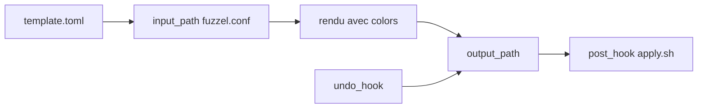

# noctalia-dev/community-templates

> Modèles communautaires de thèmes qui appliquent les couleurs de Noctalia aux configurations d'applications Linux.

## Le problème
Chaque application Linux a son format de thème ; garder les couleurs cohérentes avec le shell demande un fichier par application.

## Ce que ça fait vraiment
Un dossier par application contient un `template.toml`, le fichier de config avec la syntaxe de gabarit Noctalia et un `apply.sh` optionnel. Noctalia rend le gabarit avec la palette courante, l'écrit dans la config de l'application et lance un hook. Le dépôt sert surtout de guide de contribution : une application par PR, un README et une capture.

## Comment c'est branché
Schéma simplifié d'après la fiche, sans diagramme fourni.



## Essayer
```bash
noctalia theme --list-templates
```
Le test passe par un « user template » déclaré dans `~/.config/noctalia/config.toml`.

## Coût et pièges
Gratuit, mais il faut le shell Noctalia. Les hooks s'exécutent avec les droits de l'utilisateur à chaque changement de thème : à relire ligne par ligne. Le catalogue n'affiche aucune licence.

## Ce que ce n'est pas
Pas un outil autonome : sans Noctalia, rien n'est appliqué. Ce n'est pas un thème en soi.

## Alternatives
Aucune alternative nommée dans le README.

## Pour toi
À ignorer : sert à personnaliser un bureau Linux, sans lien avec un travail data, IA ou MLOps.

