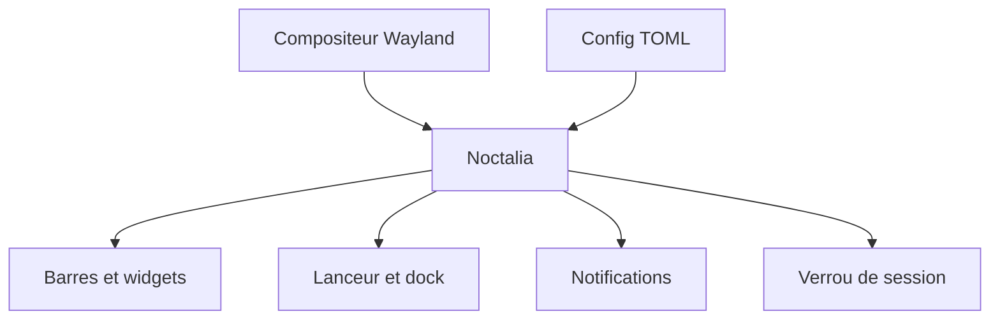

# noctalia-dev/noctalia

> Native Wayland desktop environment bundling bar, launcher, notifications and lock screen.

## The problem
A customized Wayland desktop forces you to assemble a separate bar, launcher, notification daemon, lock screen and wallpaper tool.

## What it actually does
A native "shell" layer, without Qt or GTK, built on Wayland and OpenGL ES: multi-monitor bars, dock, launcher, control center, notifications, wallpaper picker, lock screen, clipboard history, widgets. TOML configuration with hot reload and IPC. It is not a complete desktop environment: the window manager stays elsewhere.

## How it is wired


## Trying it
```bash
# Aucune commande documentée dans le README ; voir BUILDING.md pour la compilation.
```

## Cost and gotchas
Free. Build from source following BUILDING.md; a compatible Wayland compositor is required.

## What it is not
Not a window manager nor an application suite. Secondary features go through plugins, outside the core.

## Alternatives
No alternative cited in the README.

## For you
Ignore: Linux desktop customization, unrelated to your data / AI / MLOps work.
