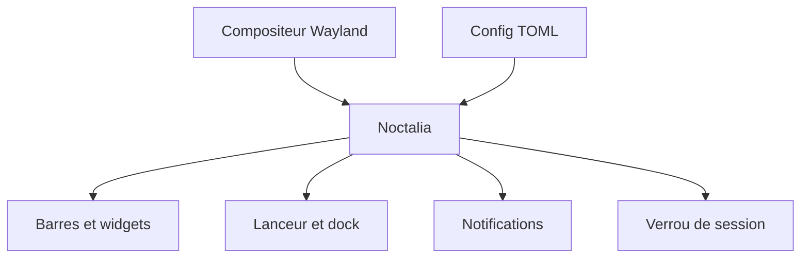

# noctalia-dev/noctalia

> Environnement de bureau Wayland natif regroupant barre, lanceur, notifications et écran de verrouillage.

## Le problème
Un bureau Wayland personnalisé oblige à assembler barre, lanceur, démon de notifications, verrou et fond d'écran séparés.

## Ce que ça fait vraiment
Une couche « shell » native, sans Qt ni GTK, bâtie sur Wayland et OpenGL ES : barres multi-écrans, dock, lanceur, centre de contrôle, notifications, sélecteur de fonds, verrou, historique du presse-papiers, widgets. Configuration TOML à rechargement à chaud et IPC. Ce n'est pas un environnement de bureau complet : le gestionnaire de fenêtres reste ailleurs.

## Comment c'est branché


## Essayer
```bash
# Aucune commande documentée dans le README ; voir BUILDING.md pour la compilation.
```

## Coût et pièges
Gratuit. Compilation depuis les sources selon BUILDING.md ; il faut un compositeur Wayland compatible.

## Ce que ce n'est pas
Pas un gestionnaire de fenêtres ni une suite d'applications. Les fonctions secondaires passent par des plugins, hors du cœur.

## Alternatives
Aucune alternative citée dans le README.

## Pour toi
À ignorer : personnalisation de bureau Linux, sans lien avec ton travail data / IA / MLOps.

