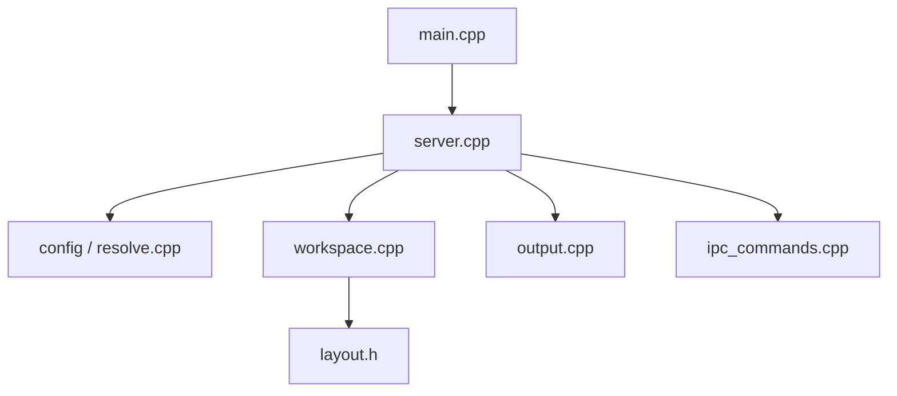

# noctalia-dev/umbriel

> Young Wayland compositor written in C++23, with several window layouts, for the Linux desktop.

## The problem
According to its authors, existing compositors did not combine productivity and gaming on the same desktop.

## What it actually does
Wayland compositor (wlroots, with umbrielfx, a fork of SceneFX): scrolling, dwindle, master and stacking layouts, per-screen workspaces, window rules, blur, shadows, HDR, variable refresh rate. Hot-reloaded TOML configuration, IPC, on-demand Xwayland. Pairs with the Noctalia shell.

## How it is wired


## Trying it
```bash
start-umbriel
cp examples/config.toml ~/.config/umbriel/config.toml
```
The rest (packages, Nix, compilation) points to an installation guide.

## Cost and gotchas
Free. The README warns that configuration keys and shortcuts may change between versions. More than 180 open issues.

## What it is not
Not a complete desktop: the shell comes from Noctalia. Linux and Wayland only.

## Alternatives
No alternative named in the README.

## For you
Ignore: Linux desktop component, unrelated to data/AI work.
