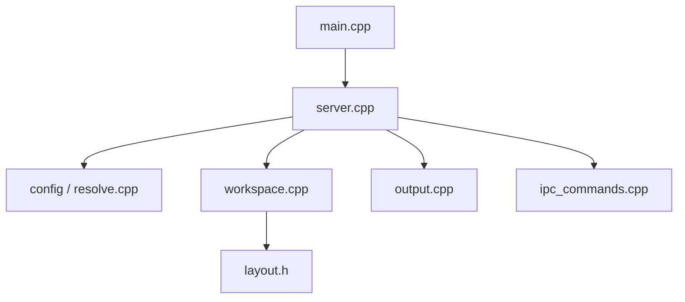

# noctalia-dev/umbriel

> Compositeur Wayland jeune, en C++23, avec plusieurs dispositions de fenêtres, pour bureau Linux.

## Le problème
Les compositeurs existants ne combinaient pas, selon les auteurs, productivité et jeu sur un même bureau.

## Ce que ça fait vraiment
Compositeur Wayland (wlroots, avec umbrielfx, fork de SceneFX) : dispositions scrolling, dwindle, master et stacking, espaces de travail par écran, règles de fenêtres, flou, ombres, HDR, taux de rafraîchissement variable. Configuration TOML rechargée à chaud, IPC, Xwayland à la demande. Se marie avec le shell Noctalia.

## Comment c'est branché


## Essayer
```bash
start-umbriel
cp examples/config.toml ~/.config/umbriel/config.toml
```
Le reste (paquets, Nix, compilation) renvoie vers un guide d'installation.

## Coût et pièges
Gratuit. Le README prévient que clés de configuration et raccourcis peuvent changer entre versions. Plus de 180 issues ouvertes.

## Ce que ce n'est pas
Pas un bureau complet : le shell vient de Noctalia. Linux et Wayland uniquement.

## Alternatives
Aucune alternative nommée dans le README.

## Pour toi
Ignorer : composant de bureau Linux, sans rapport avec le travail data/IA.

