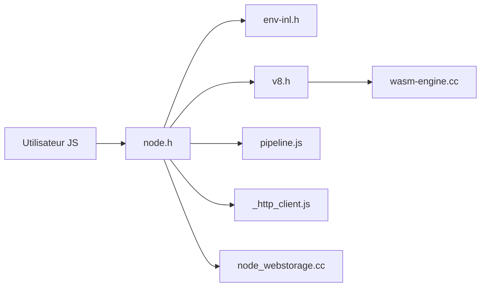

# nodejs/node

> Open source, cross-platform JavaScript runtime environment, for back-end developers, tooling and scripts.

## The problem
Running JavaScript outside the browser, with access to files, the network and streams.

## What it actually does
Provides the runtime that embeds V8 and exposes APIs: streams, HTTP client, SQLite-backed web storage, inspector, QUIC, cryptography. Releases follow a cycle: Current, LTS (even numbers, 12 months active then 18 of maintenance) and Nightly. Governance is open, backed by the OpenJS Foundation.

## How it is wired


## Trying it
```bash
curl -fsLo "/path/to/nodejs-keyring.kbx" "https://github.com/nodejs/release-keys/raw/HEAD/gpg/pubring.kbx"
curl -fsO "https://nodejs.org/dist/${VERSION}/SHASUMS256.txt.asc" \
&& gpgv --keyring="/path/to/nodejs-keyring.kbx" --output SHASUMS256.txt < SHASUMS256.txt.asc \
&& shasum --check SHASUMS256.txt --ignore-missing
```
These commands verify a downloaded binary; installation goes through the website or BUILDING.md.

## Cost and gotchas
Free. The choice between Current and LTS matters: October Current releases get only 8 months of support. Building from source is heavy (see BUILDING.md).

## What it is not
Not a web framework nor a package manager in this README. The internal architecture is not documented there. The license is present but not identified by GitHub: to be checked.

## Alternatives
No alternative named in the README.

## For you
Adopt, on LTS: it is the foundation of all JS tooling (MCP, dashboards, notebooks) and its support cycle is clear.
