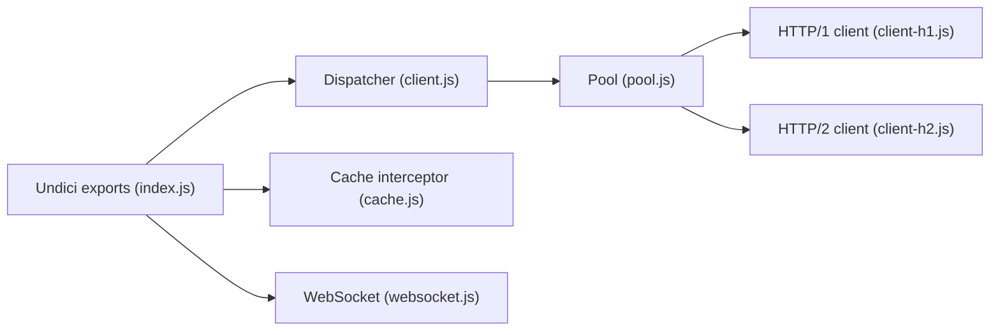

# nodejs/undici

> HTTP/1.1 client written from scratch for Node.js, with a fetch implementation.

## The problem
Node's `http` module is cumbersome to use and offers little configuration for connection pooling.

## What it actually does
`request`, `stream`, `pipeline`, `fetch`, `upgrade`, `connect` APIs, with dispatcher, pools, HTTP/1 and HTTP/2, pipelining, interceptors, HTTP cache (memory or SQLite), `ProxyAgent`, `MockAgent`. `install()` replaces the fetch, WebSocket and EventSource globals. Node's built-in fetch relies on a bundled version.

## How it is wired


## Trying it
```bash
npm i undici
```
```js
import { request } from 'undici'
const { statusCode, body } = await request('http://localhost:3000/foo')
```

## Cost and gotchas
Free. You must always consume or cancel the response body, or connections leak. No CORS and no `Expect`.

## What it is not
Not a browser-side client. The benchmark figures come from the README (Node 24.14.1).

## Alternatives
None named as a choice; the README compares against node-fetch, axios, got, superagent.

## For you
Keep an eye on it: only useful if you write Node (LLM API clients); irrelevant on the Python side.
