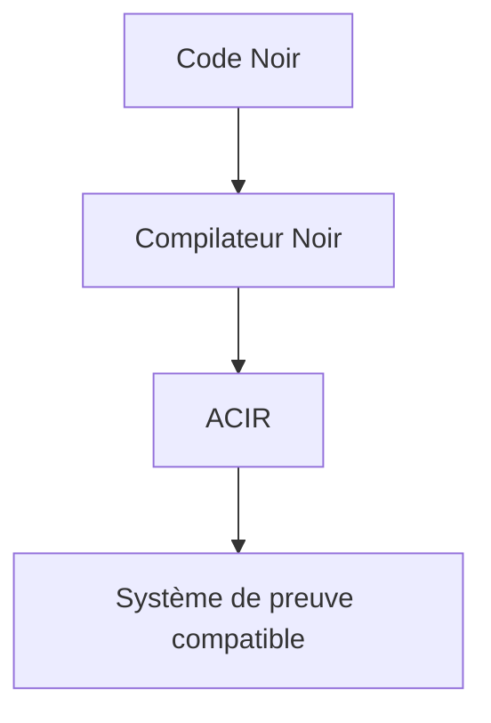

# noir-lang/noir

> Domain-specific language for writing SNARK proof circuits, compatible with any ACIR proof system.

## The problem
Writing zero-knowledge proof circuits by hand is hard and fragile. A language aimed at safety and developer comfort is needed.

## What it actually does
A domain-specific language for SNARK proof systems, designed for any ACIR-compatible system. The README states that the implementation is in early development, neither reviewed nor audited, and not suitable for production. Installation details are deferred to the documentation.

## How it is wired
Not documented in the README nor by a supplied diagram. Simplified schema based on the fiche, no diagram supplied.

## Trying it
No command in the README: read the "Getting started" section of the online documentation. Examples on Awesome Noir.

## Cost and gotchas
Free. Rust 1.89.0 minimum to build the repository. 826 open issues, alpha phase: expect bugs.

## What it is not
Not an audited tool nor production-ready. Not a proof system: it targets those that speak ACIR.

## Alternatives
No alternative named in the README.

## For you
Watch: useful if you touch verifiable ML or ZK proofs, but the unaudited alpha rules out any serious use.
