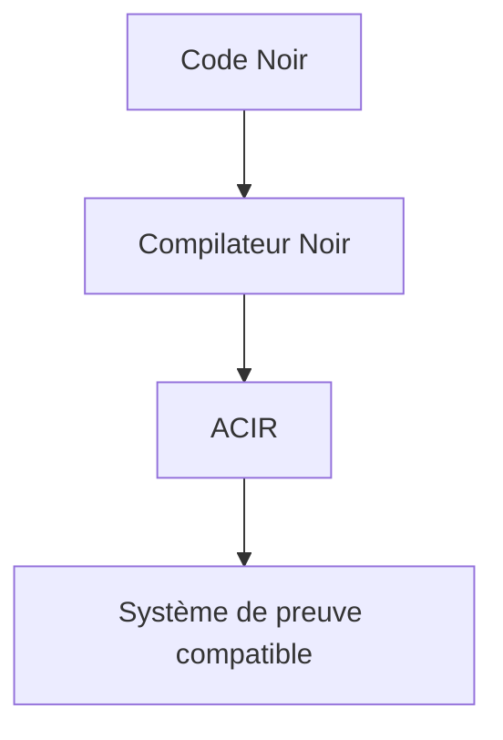

# noir-lang/noir

> Langage dédié pour écrire des circuits de preuves SNARK, compatible avec tout système de preuve ACIR.

## Le problème
Écrire des circuits de preuve à connaissance nulle à la main est ardu et fragile. Il faut un langage qui vise la sécurité et le confort du développeur.

## Ce que ça fait vraiment
Un langage dédié aux systèmes de preuves SNARK, conçu pour tout système compatible ACIR. Le README annonce une implémentation en développement précoce, ni revue ni auditée, non adaptée à la production. Détails d'installation renvoyés à la documentation.

## Comment c'est branché
Non documenté dans le README ni par un diagramme fourni. Schéma simplifié d'après la fiche, sans diagramme fourni.

## Essayer
Aucune commande dans le README : lire la section « Getting started » de la documentation en ligne. Exemples sur Awesome Noir.

## Coût et pièges
Gratuit. Rust 1.89.0 minimum pour compiler le dépôt. 826 issues ouvertes, phase alpha : attends-toi à des bogues.

## Ce que ce n'est pas
Pas un outil audité ni prêt pour la production. Ce n'est pas un système de preuve : il cible ceux qui parlent ACIR.

## Alternatives
Aucune alternative nommée dans le README.

## Pour toi
Surveiller : utile si tu touches au ML vérifiable ou aux preuves ZK, mais l'alpha non auditée interdit tout usage sérieux.

