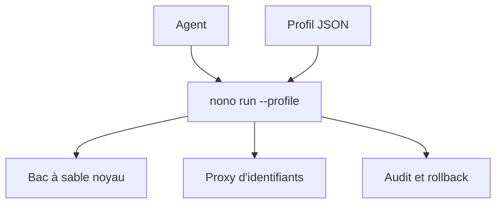

# nolabs-ai/nono

> Runs AI agents in a kernel sandbox, with controlled credentials, network and audit.

## The problem
An agent that launches tools can read files, steal keys or reach out to the network with no safeguard.

## What it actually does
A single binary, no root rights, isolates each tool in a sandbox (files, network, variables, credentials). Keys stay outside the agent, injected through a proxy. The network is filtered by domain, method and path. It verifies skills via Sigstore, keeps a signed audit and restores files from snapshots. Composable JSON profiles. Same content as always-further/nono.

## How it is wired
Simplified diagram based on the sheet, no diagram provided.


## Trying it
```bash
curl -fsSL https://nono.sh/install.sh | sh
brew install nono
nono search pi
nono pull nolabs-ai/pi
nono run --profile nolabs-ai/pi -- pi
```

## Cost and gotchas
Free. The API is still changing before 1.0. Windows only via WSL2.

## What it is not
Not an antivirus nor a general firewall: it protects what runs under nono. Both repositories present the same README.

## Alternatives
No alternative named in the README.

## For you
Worth adopting: putting boundaries on an agent that touches your API keys and your data is a real need, and the tool is lightweight.
