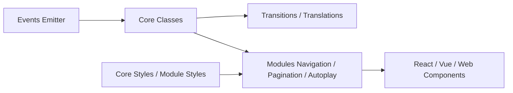

# nolimits4web/swiper

> Modern touch carousel with no dependencies, for websites and mobile web apps.

## The problem
Swiping slides with a finger, with smooth transitions, pagination and navigation, without rewriting touch handling.

## What it actually does
Swiper offers a slider with 1:1 touch movement, RTL, multi-row grid, effects (fade, flip, 3D cube, coverflow), loop, autoplay, lazy image loading, virtual slides, accessibility. It works without jQuery and loads by modules. The code is split into core (events, transitions, breakpoints), modules (navigation, pagination, zoom, thumbs…) and React, Vue and Web Components integrations.

## How it is wired


## Trying it
```bash
npm install
npm run build
npm run core
npm run react
npm run vue
npm run build:prod
```

## Cost and gotchas
Free; Node to build. For production, use only the files in the `dist/` folder. Swiper targets modern platforms only.

## What it is not
Neither a UI framework nor a media player: a scrolling component.

## Alternatives
- No alternative named in the README.

## For you
Ignore: a web interface carousel brings nothing to a data/AI/MLOps workflow, except for a very specific front-end demo.
