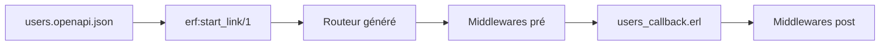

# nomasystems/erf

> Erlang framework that starts a REST server from an OpenAPI 3.0 specification.

## The problem
Hand-writing routing and validation for REST APIs repeats code that the specification already contains.

## What it actually does
Takes an OpenAPI file and a callback module, starts a server (on top of elli) and generates the router that validates requests. Provides pre- and post-processing middlewares, several specifications mounted under prefixes, hot configuration reload, Swagger UI and static routes.

## How it is wired


## Trying it
```bash
rebar3 as examples shell
curl -vvv 'localhost:8080/users' -H 'Content-Type: application/json' -H 'X-API-KEY: api-key' -d '{"username": "foo", "password": "foobar"}'
```

## Cost and gotchas
Free. Requires Erlang/OTP 27 or later and rebar3. OpenAPI path parameters must be strings.

## What it is not
Not a source code generator: the router is produced dynamically. No HTTP/2 mentioned (elli base is HTTP 1.1).

## Alternatives
No alternative named in the README.

## For you
Ignore: Erlang framework, of no interest for a Python data or AI stack.
