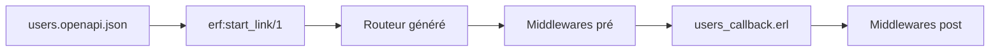

# nomasystems/erf

> Framework Erlang qui démarre un serveur REST à partir d'une spécification OpenAPI 3.0.

## Le problème
Écrire à la main routage et validation d'API REST répète du code que la spécification contient déjà.

## Ce que ça fait vraiment
Prend un fichier OpenAPI et un module de rappel, démarre un serveur (au-dessus d'elli) et génère le routeur qui valide les requêtes. Fournit des middlewares avant et après traitement, plusieurs spécifications montées sous des préfixes, rechargement de configuration à chaud, Swagger UI et routes statiques.

## Comment c'est branché


## Essayer
```bash
rebar3 as examples shell
curl -vvv 'localhost:8080/users' -H 'Content-Type: application/json' -H 'X-API-KEY: api-key' -d '{"username": "foo", "password": "foobar"}'
```

## Coût et pièges
Gratuit. Exige Erlang/OTP 27 ou plus et rebar3. Les paramètres de chemin OpenAPI doivent être des chaînes.

## Ce que ce n'est pas
Pas un générateur de code source : le routeur est produit dynamiquement. Pas de HTTP/2 évoqué (base elli HTTP 1.1).

## Alternatives
Aucune alternative nommée dans le README.

## Pour toi
À ignorer : framework Erlang, sans intérêt pour une pile Python de data ou d'IA.

