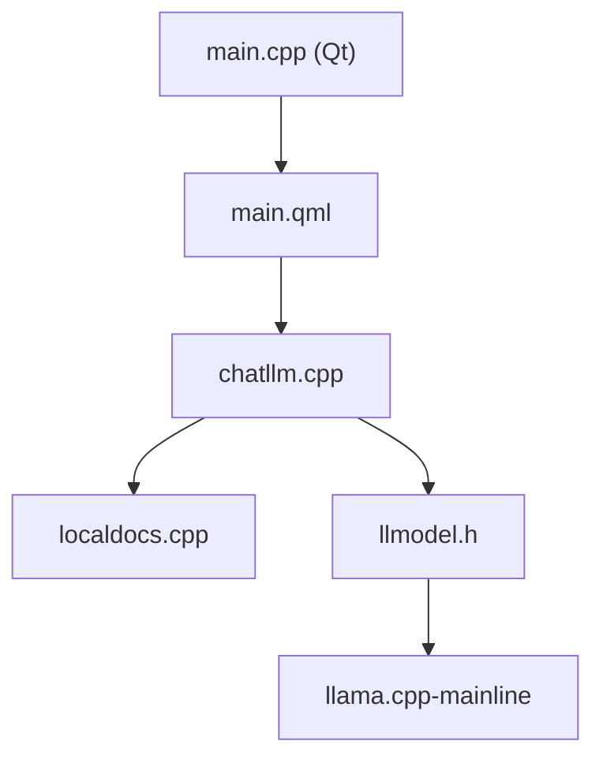

# nomic-ai/gpt4all

> Desktop application and Python client for running quantized LLMs locally, without requiring an API or GPU.

## The problem
Use a large language model without sending your data to a hosted service or having a GPU.

## What it actually does
An Qt/QML application (for chat, a model catalog, and LocalDocs for querying your documents) calls a C++ backend based on `llama.cpp`. Python and TypeScript bindings, along with a command-line interface (CLI), expose this same backend. The application downloads the catalog and models; inference remains local. An optional server and a DeepSpeed training environment are also available.

## How it is wired


## Trying it
```bash
pip install gpt4all
```
```python
from gpt4all import GPT4All
model = GPT4All("Meta-Llama-3-8B-Instruct.Q4_0.gguf")
with model.chat_session():
    print(model.generate("How can I run LLMs efficiently on my laptop?", max_tokens=1024))
```

## Cost and gotchas
Free. The example model weighs 4.66 GB. The last update was on 2025-05-27, with 775 open issues – activity appears to have slowed down.

## What it is not
This is not a production inference server. The models are quantized and smaller than those hosted; the README does not provide benchmark results.

## Alternatives
No alternative is specified in the README (referencing `llama.cpp` as the base).

## For you
Things to watch out for: Suitable for a local prototype with RAG on documents, but the last update is 17 months old; verify its accuracy before relying on it.
