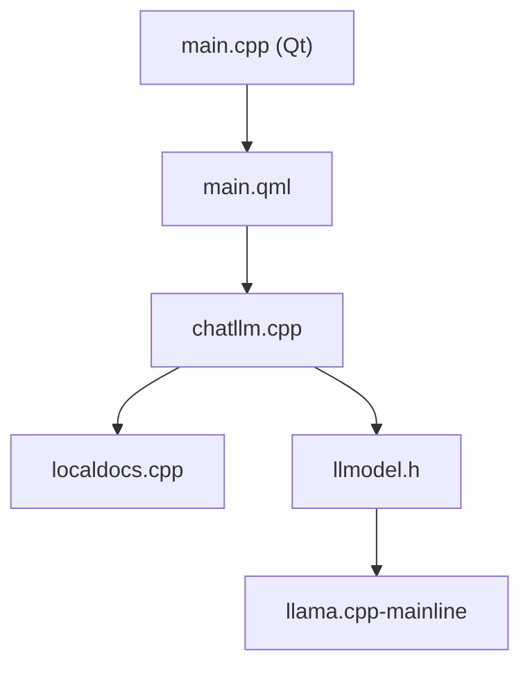

# nomic-ai/gpt4all

> Application de bureau et client Python pour faire tourner des LLM quantifiés en local, sans API ni GPU.

## Le problème
Utiliser un LLM sans envoyer ses données à un service hébergé ni disposer d'un GPU.

## Ce que ça fait vraiment
Une appli Qt/QML (chat, catalogue de modèles, LocalDocs pour interroger tes documents) appelle un backend C++ basé sur `llama.cpp`. Des bindings Python et TypeScript et un CLI exposent le même backend. L'appli télécharge catalogue et modèles ; l'inférence reste locale. Un serveur optionnel et un espace d'entraînement DeepSpeed existent aussi.

## Comment c'est branché


## Essayer
```bash
pip install gpt4all
```
```python
from gpt4all import GPT4All
model = GPT4All("Meta-Llama-3-8B-Instruct.Q4_0.gguf")
with model.chat_session():
    print(model.generate("How can I run LLMs efficiently on my laptop?", max_tokens=1024))
```

## Coût et pièges
Gratuit. Le modèle d'exemple pèse 4,66 Go. Dernier push le 2025-05-27, avec 775 issues ouvertes : l'activité semble ralentie.

## Ce que ce n'est pas
Pas un serveur d'inférence de production. Les modèles sont quantifiés et plus petits que les modèles hébergés ; le README ne donne pas de benchmark.

## Alternatives
Aucune alternative nommée dans le README (cite `llama.cpp` comme base).

## Pour toi
À surveiller : bon pour un prototype local avec RAG sur documents, mais dernier push vieux de 17 mois ; vérifie la vitalité avant de t'y fier.

