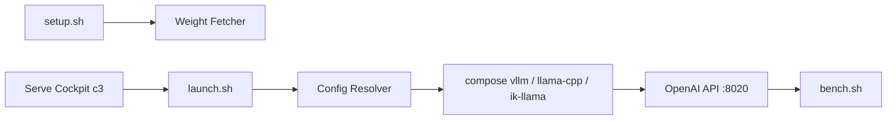

# noonghunna/club-3090

> Recipes and benchmarks for serving LLMs locally on one or two RTX 3090s.

## The problem
Fitting a 27-billion-parameter model into 24 GB of VRAM requires configurations, patches and engine choices that are hard to find.

## What it actually does
A repository of validated docker compose configurations, scripts and patches for vLLM, llama.cpp and ik_llama, with Qwen3.6-27B as the curated model. Helpers (`setup.sh`, `launch.sh`, `switch.sh`) download the weights, pick a variant according to the hardware and expose an OpenAI-compatible API on `localhost:8020`. Benchmarks, stress tests and diagnostic reports are provided, along with a TUI cockpit `c3`.

## How it is wired


## Trying it
```bash
git clone https://github.com/noonghunna/club-3090.git
cd club-3090
bash scripts/setup.sh
bash scripts/launch.sh
curl -sf http://localhost:8020/v1/chat/completions \
  -H "Content-Type: application/json" \
  -d '{"model":"qwen3.6-27b","messages":[{"role":"user","content":"Capital of France?"}],"max_tokens":200}'
bash scripts/bench.sh
```

## Cost and gotchas
One or two RTX 3090s, Linux (WSL2 on Windows), Docker + NVIDIA Container Toolkit, driver 580+, about 30 GB per model. On a single card, a prefill "cliff" remains open beyond ~50 K tokens.

## What it is not
Not an inference engine: it assembles vLLM, llama.cpp and ik_llama. Not meant for 12 GB cards or for native macOS/Windows.

## Alternatives
- vLLM, llama.cpp, ik_llama: the engines it orchestrates, usable on their own.

## For you
Adopt it if you have a 3090 and want to serve a local LLM without trial and error: measured figures and reproducible scripts.
