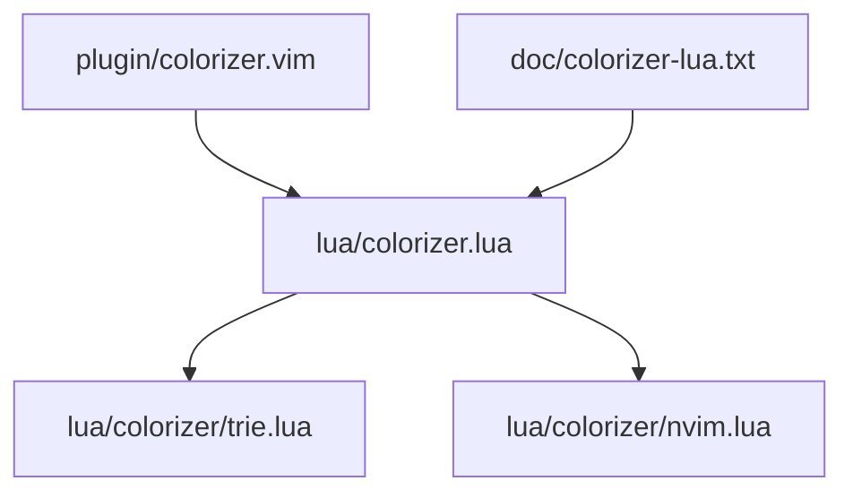

# norcalli/nvim-colorizer.lua

> Neovim plugin that colors color codes (hex, names, rgb) live in the text.

## The problem
Reading `#ff9900` or `rgb(...)` in a file without seeing the color forces you to guess it.

## What it actually does
Parses the buffer with a hand-written LuaJIT parser and a trie to recognize color names, then applies highlights. Options: hex RGB, RRGGBB, names, CSS functions, foreground or background mode. No external dependency.

## How it is wired


## Trying it
```lua
Plug 'norcalli/nvim-colorizer.lua'
require'colorizer'.setup()
```

## Cost and gotchas
Free. Requires Neovim 0.4 or later and `termguicolors`. Last push in July 2024: little followed.

## What it is not
Not compatible with classic Vim: Neovim only, the README says so. No recent maintenance.

## Alternatives
hexokinase, cited in the README as performant but sometimes out of sync.

## For you
Ignore: editor cosmetics, and a project with no commit since 2024.
