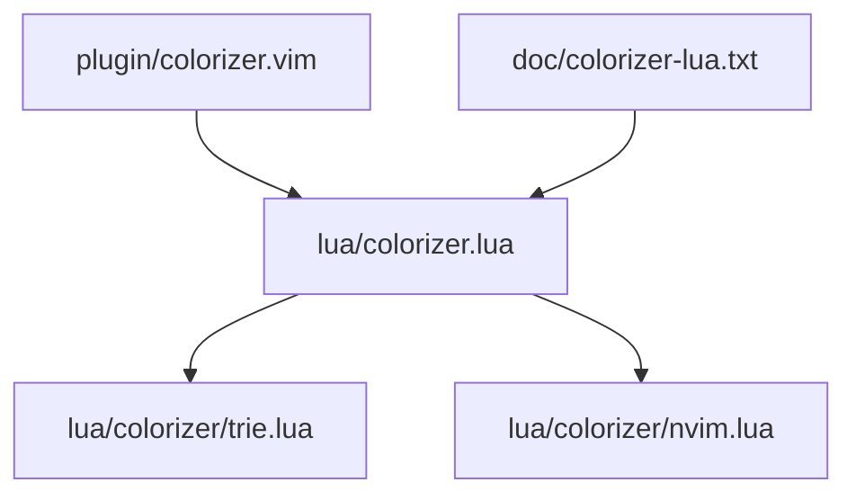

# norcalli/nvim-colorizer.lua

> Plugin Neovim qui colorie en direct les codes couleur (hex, noms, rgb) dans le texte.

## Le problème
Lire `#ff9900` ou `rgb(...)` dans un fichier sans voir la couleur oblige à la deviner.

## Ce que ça fait vraiment
Analyse le tampon avec un parseur écrit à la main en LuaJIT et un trie pour reconnaître les noms de couleurs, puis applique les surbrillances. Options : hex RGB, RRGGBB, noms, fonctions CSS, mode avant-plan ou arrière-plan. Sans dépendance externe.

## Comment c'est branché


## Essayer
```lua
Plug 'norcalli/nvim-colorizer.lua'
require'colorizer'.setup()
```

## Coût et pièges
Gratuit. Requiert Neovim 0.4 ou plus et `termguicolors`. Dernier push en juillet 2024 : peu suivi.

## Ce que ce n'est pas
Pas compatible Vim classique : Neovim seulement, le README le dit. Pas de maintenance récente.

## Alternatives
hexokinase, cité dans le README comme performant mais parfois désynchronisé.

## Pour toi
Ignorer : cosmétique d'éditeur, et projet sans commit depuis 2024.

