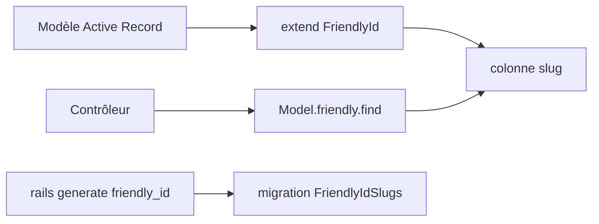

# norman/friendly_id

> Ruby on Rails gem that replaces numeric identifiers in URLs with readable slugs.

## The problem
URLs like `/states/4323454` are unreadable, and not very useful for SEO.

## What it actually does
It adds a `slug` column to an Active Record model and lets you search with `User.friendly.find`. It handles slug history, i18n, scoped slugs, reserved words and custom generators.

## How it is wired

Simplified diagram based on the sheet, no diagram provided.

## Trying it
```bash
bundle install
rails g migration AddSlugToUsers slug:uniq
rails generate friendly_id
rails db:migrate
```

## Cost and gotchas
Free. Ruby and Rails are required (a need outside the list of prerequisites). Version 5.0.0 or later is required for Rails 4. Slugs for an existing database are generated with `User.find_each(&:save)`.

## What it is not
It is not a router: it only handles slug generation and lookup.

## Alternatives
The README names none.

## For you
Ignore: a Rails tool for clean URLs, unrelated to data / AI / MLOps work.
