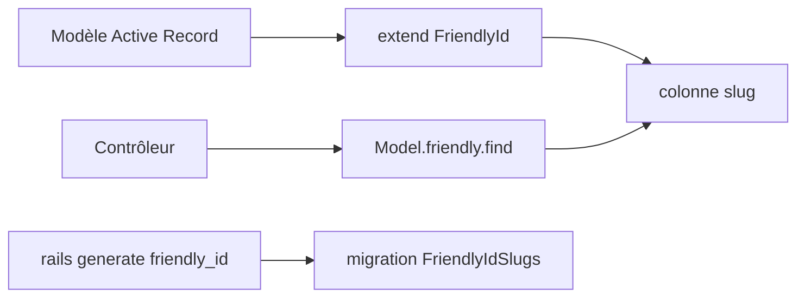

# norman/friendly_id

> Gem Ruby on Rails qui remplace les identifiants numériques des URL par des slugs lisibles.

## Le problème
Des URL comme `/states/4323454` sont illisibles, et peu utiles pour le référencement.

## Ce que ça fait vraiment
Elle ajoute une colonne `slug` à un modèle Active Record et permet de chercher avec `User.friendly.find`. Elle gère l'historique des slugs, l'i18n, les slugs à portée, les mots réservés et des générateurs personnalisés.

## Comment c'est branché

Schéma simplifié d'après la fiche, sans diagramme fourni.

## Essayer
```bash
bundle install
rails g migration AddSlugToUsers slug:uniq
rails generate friendly_id
rails db:migrate
```

## Coût et pièges
Gratuit. Il faut Ruby et Rails (besoin hors liste de prérequis). La version 5.0.0 ou plus est requise pour Rails 4. Les slugs d'une base existante se génèrent avec `User.find_each(&:save)`.

## Ce que ce n'est pas
Ce n'est pas un routeur : il ne gère que la génération et la recherche de slugs.

## Alternatives
Le README n'en nomme aucune.

## Pour toi
À ignorer : outil Rails pour des URL propres, sans lien avec un travail data / IA / MLOps.

