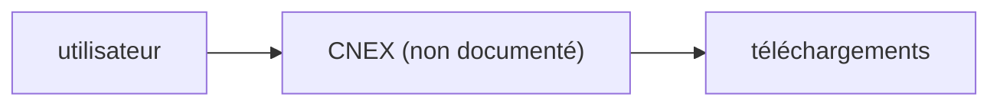

# notFaad/coom-dl

> Download manager whose README says almost nothing, apart from donation addresses.

## The problem
Undocumented: the README describes no problem addressed.

## What it actually does
The README is a few lines long: a "CNEX" title, the sentence "A Modern Downloader Manager" and donation addresses (crypto, Buy me a coffee). Nothing on how it works.

## How it is wired
Simplified diagram based on the sheet, no diagram provided.

## Trying it
No documented command.

## Cost and gotchas
No license declared: usage rights are unclear. Last push in September 2025. Installation and dependencies unknown.

## What it is not
Not a documented or auditable project. The repository name (coom-dl) and the README title (CNEX) do not match.

## Alternatives
No alternative named in the README.

## For you
Ignore: no usable information, no license, no link with your data or AI work.
