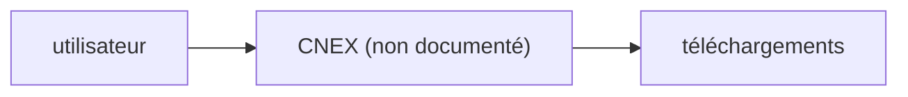

# notFaad/coom-dl

> Gestionnaire de téléchargements dont le README ne dit presque rien, hormis des adresses de dons.

## Le problème
Non documenté : le README ne décrit aucun problème traité.

## Ce que ça fait vraiment
Le README tient en quelques lignes : un titre « CNEX », la phrase « A Modern Downloader Manager » et des adresses de dons (crypto, Buy me a coffee). Rien sur le fonctionnement.

## Comment c'est branché
Schéma simplifié d'après la fiche, sans diagramme fourni.

## Essayer
Aucune commande documentée.

## Coût et pièges
Aucune licence déclarée : les droits d'usage sont flous. Dernier push en septembre 2025. Installation et dépendances inconnues.

## Ce que ce n'est pas
Pas un projet documenté ni auditable. Le nom du dépôt (coom-dl) et le titre du README (CNEX) ne concordent pas.

## Alternatives
Aucune alternative nommée dans le README.

## Pour toi
Ignorer : aucune information exploitable, aucune licence, aucun lien avec ton travail data ou IA.

