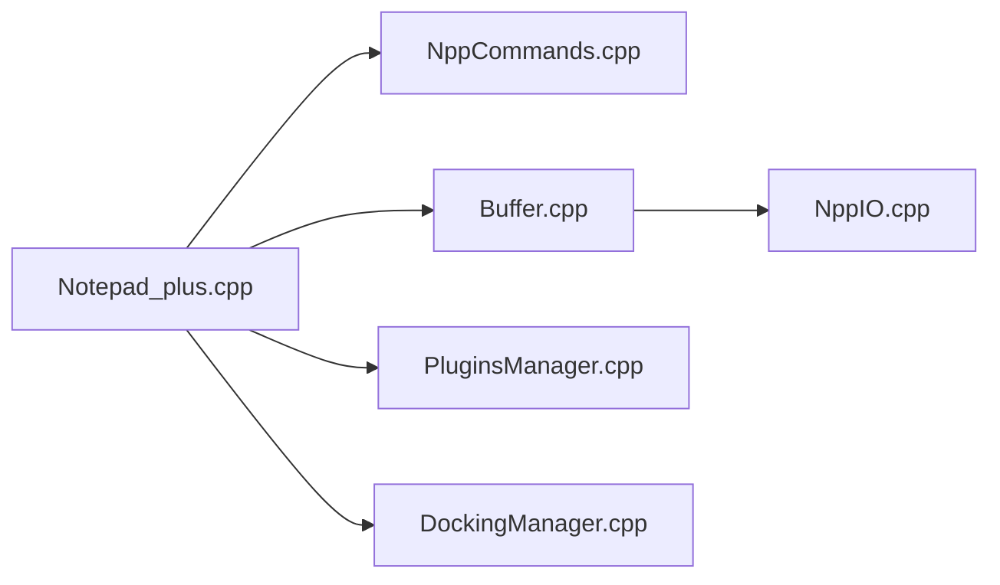

# notepad-plus-plus/notepad-plus-plus

> Code editor and Notepad replacement for Windows, GPG-signed.

## The problem
Windows Notepad is too limited for editing code or multi-encoding text.

## What it actually does
Windows editor with per-language syntax highlighting, search/replace with regular expressions, tabs, dockable panels, function list, project panel, plugins, dark mode and DPI handling. Releases have been GPG-signed since 7.6.5. The README says it is under the GPL license.

## How it is wired

## Trying it
No documented command: the README points to the official site for downloading, and to a build guide for compiling.

## Cost and gotchas
Free. Windows only. License deemed "unidentified" by GitHub despite the GPL mention in the README: to be confirmed.

## What it is not
Not an IDE, not cross-platform. 2,930 open issues.

## Alternatives
No alternative named in the README.

## For you
To ignore on the data / AI side: Windows desktop tool unrelated to your pipelines, and you probably already have a suitable editor.
