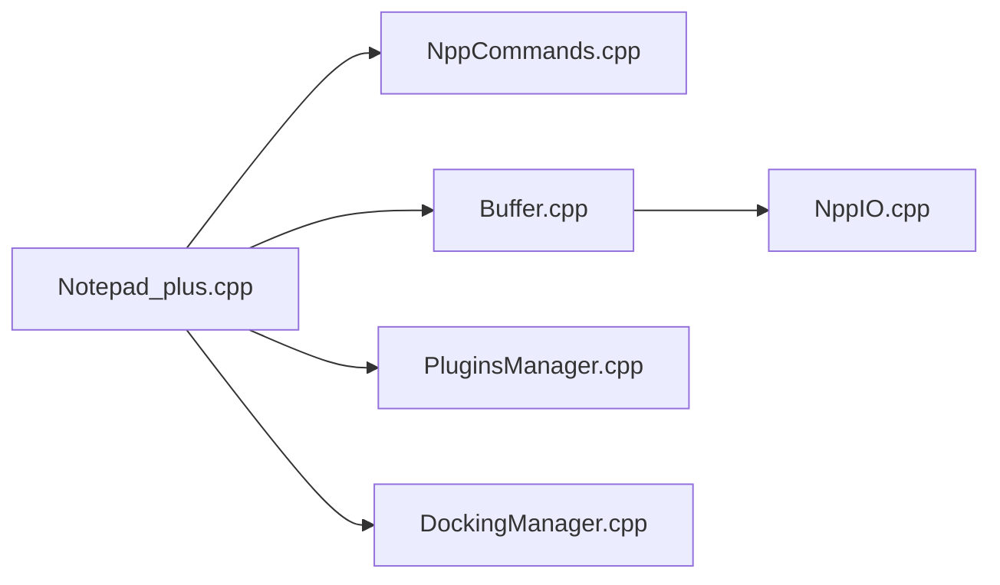

# notepad-plus-plus/notepad-plus-plus

> Éditeur de code et remplaçant du Bloc-notes pour Windows, signé GPG.

## Le problème
Le Bloc-notes de Windows est trop pauvre pour éditer du code ou du texte multi-encodages.

## Ce que ça fait vraiment
Éditeur Windows avec coloration syntaxique par langage, recherche/remplacement avec expressions régulières, onglets, panneaux ancrables, liste de fonctions, panneau de projet, plugins, mode sombre et gestion DPI. Les versions sont signées GPG depuis la 7.6.5. Le README dit qu'il est sous licence GPL.

## Comment c'est branché

## Essayer
Aucune commande documentée : le README renvoie au site officiel pour télécharger, et à un guide de build pour compiler.

## Coût et pièges
Gratuit. Windows uniquement. Licence jugée « non identifiée » par GitHub malgré la mention GPL dans le README : à confirmer.

## Ce que ce n'est pas
Pas un IDE, pas multiplateforme. 2 930 issues ouvertes.

## Alternatives
Aucune alternative nommée dans le README.

## Pour toi
À ignorer côté data / IA : outil de poste Windows sans rapport avec tes pipelines, et tu as probablement déjà un éditeur adapté.

