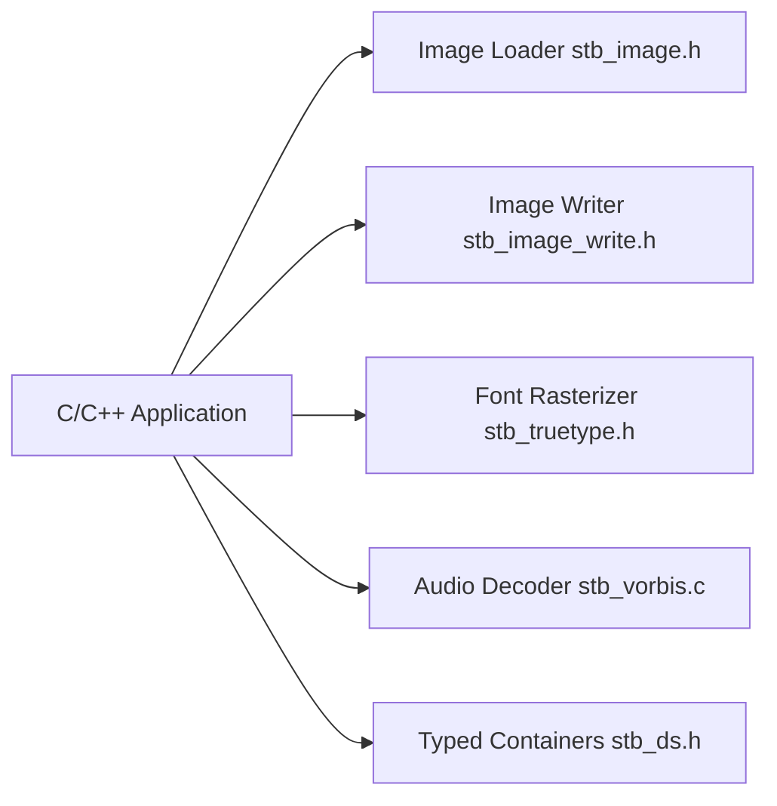

# nothings/stb

> Collection of single-file C/C++ libraries, public domain or MIT: images, fonts, audio, containers.

## The problem
Integrating image loading or font rasterization in C without managing dependencies or linking libraries.

## What it actually does
Standalone `.h` files (19 libraries, about 38,600 lines of C): `stb_image.h` (JPG, PNG, TGA, BMP, PSD, GIF, HDR, PIC), `stb_image_write.h`, `stb_truetype.h`, `stb_vorbis.c`, `stb_ds.h`, etc. You define an implementation macro in exactly one source file then include the header.

## How it is wired


## Trying it
```c
#define STB_IMAGE_IMPLEMENTATION
#include "stb_image.h"
```

## Cost and gotchas
Free. The README warns that security bugs are discussed publicly and that fixes may take time: do not use if the risk is unacceptable. License "present but unidentified" by GitHub (public domain or MIT according to the README).

## What it is not
Not a set of libraries richer than the alternatives: they may be slower or use more memory. No new image format will be added.

## Alternatives
The moved projects stb_image_resize and stb_sprintf; otherwise an equivalent library already in place (the README says there is no reason to switch).

## For you
Worth watching: useful in embedded C/C++ or for vision prototypes, to be avoided on untrusted images without hardening.
