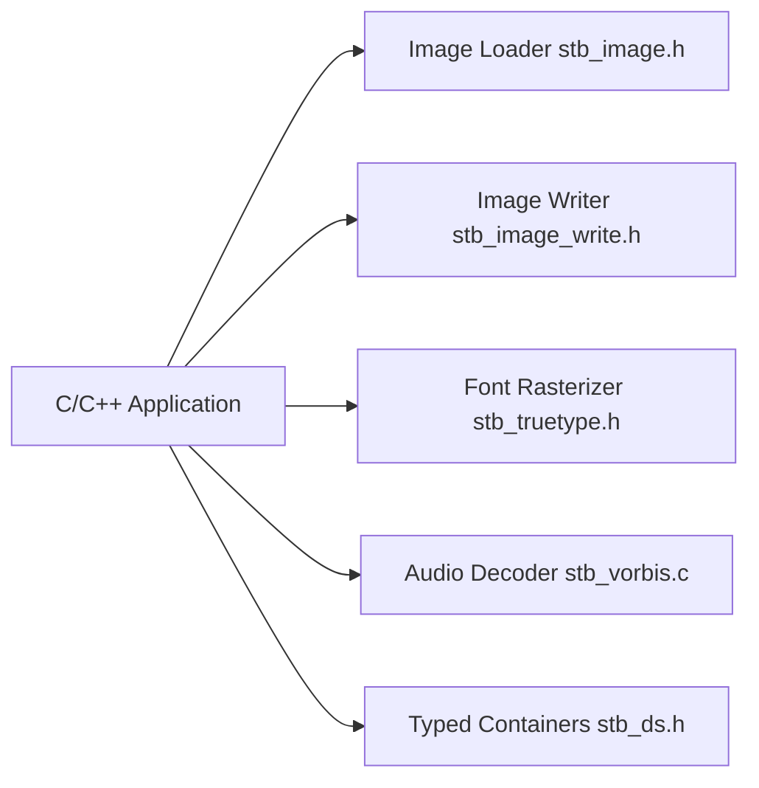

# nothings/stb

> Collection de bibliothèques C/C++ d'un seul fichier, domaine public ou MIT : images, polices, audio, conteneurs.

## Le problème
Intégrer chargement d'images ou rasterisation de polices en C sans gérer de dépendances ni de lien de bibliothèques.

## Ce que ça fait vraiment
Des fichiers `.h` autonomes (19 bibliothèques, environ 38 600 lignes de C) : `stb_image.h` (JPG, PNG, TGA, BMP, PSD, GIF, HDR, PIC), `stb_image_write.h`, `stb_truetype.h`, `stb_vorbis.c`, `stb_ds.h`, etc. On définit une macro d'implémentation dans exactement un fichier source puis on inclut l'en-tête.

## Comment c'est branché


## Essayer
```c
#define STB_IMAGE_IMPLEMENTATION
#include "stb_image.h"
```

## Coût et pièges
Gratuit. Le README avertit que les bugs de sécurité sont discutés publiquement et que les correctifs peuvent tarder : à ne pas utiliser si le risque est inacceptable. Licence « présente mais non identifiée » par GitHub (domaine public ou MIT selon le README).

## Ce que ce n'est pas
Pas un ensemble de bibliothèques plus riches que les alternatives : elles peuvent être plus lentes ou consommer plus de mémoire. Aucun nouveau format d'image ne sera ajouté.

## Alternatives
Les projets déplacés stb_image_resize et stb_sprintf ; sinon une bibliothèque équivalente déjà en place (le README dit qu'il n'y a pas de raison de changer).

## Pour toi
À surveiller : utile en C/C++ embarqué ou pour des prototypes de vision, à éviter sur des images non fiables sans durcissement.

