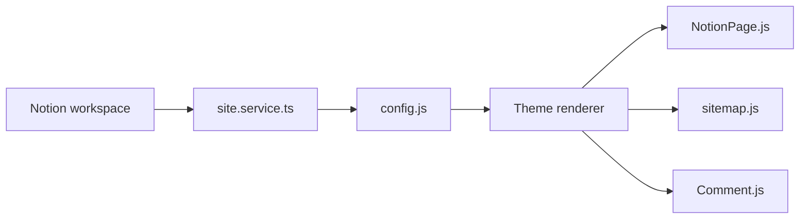

# notionnext-org/NotionNext

> Next.js-based site system that publishes Notion pages as a blog, documentation or product site.

## The problem
Writing in Notion while having an independent site, with its own theme, SEO and domain.

## What it actually does
Loads content via the Notion API, processes it, renders it with one of 26 themes. Adds Algolia search, comments (Twikoo, Giscus…), sharing, sitemap, RSS, statistics; AI chat endpoints exist in the code. Typical deployment: Notion template, fork, Vercel.

## How it is wired


## Trying it
```bash
nvm use || nvm install
npm i -g yarn
yarn
yarn dev
```

## Cost and gotchas
Node 22 and Yarn 1 (Node 20 no longer works). Depends on Notion and Vercel. README in Chinese.

## What it is not
Not a standalone CMS: everything comes from Notion. The README restricts use to personal learning and lawful sites.

## Alternatives
No alternative named in the README.

## For you
Ignore for a data/AI profile: a blog tool unrelated to your work, unless you publish your documentation from Notion.
