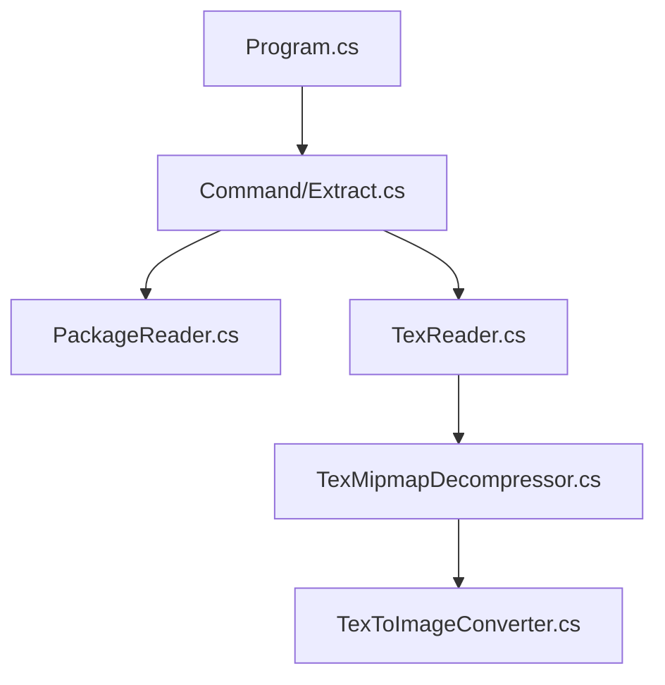

# notscuffed/repkg

> Command-line tool that extracts Wallpaper Engine PKG files and converts TEX textures into images.

## The problem
Wallpaper Engine animated wallpapers are packaged in proprietary formats unreadable without a tool.

## What it actually does
The `extract` command reads a PKG with PackageReader, then reads each TEX texture, decompresses its mipmaps and converts it into an image. It can recreate a Wallpaper Engine project. The `info` command displays the contents of a PKG or a TEX. The formats were reverse-engineered by the author.

## How it is wired


## Trying it
```bash
repkg extract E:\Games\steamapps\workshop\content\123\scene.pkg
repkg extract -c E:\Games\steamapps\workshop\content\123
repkg extract -e tex -s -o ./output E:\Games\steamapps\workshop\content\123
repkg extract -t -s E:\path\to\dir\with\tex\files
```

## Cost and gotchas
Free, MIT. Last push in October 2025, more than a year ago: little-active project. You must own the PKGs (Steam Workshop); the legality of reusing them depends on their authors.

## What it is not
Not a wallpaper viewer or editor: it only extracts. The README does not document installing the binary.

## Alternatives
No alternative named in the README.

## For you
Ignore: a niche game utility, unrelated to data, AI or MLOps work, and poorly maintained.
