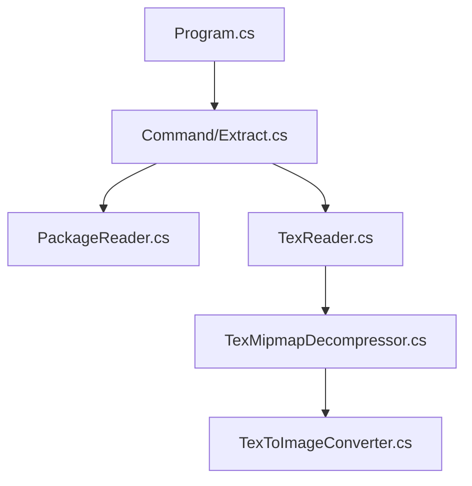

# notscuffed/repkg

> Outil en ligne de commande qui extrait les fichiers PKG de Wallpaper Engine et convertit les textures TEX en images.

## Le problème
Les fonds d'écran animés de Wallpaper Engine sont empaquetés en formats propriétaires illisibles sans outil.

## Ce que ça fait vraiment
La commande `extract` lit un PKG avec PackageReader, puis lit chaque texture TEX, décompresse ses mipmaps et la convertit en image. Elle peut recréer un projet Wallpaper Engine. La commande `info` affiche le contenu d'un PKG ou d'un TEX. Les formats ont été rétro-conçus par l'auteur.

## Comment c'est branché


## Essayer
```bash
repkg extract E:\Games\steamapps\workshop\content\123\scene.pkg
repkg extract -c E:\Games\steamapps\workshop\content\123
repkg extract -e tex -s -o ./output E:\Games\steamapps\workshop\content\123
repkg extract -t -s E:\path\to\dir\with\tex\files
```

## Coût et pièges
Gratuit, MIT. Dernier push en octobre 2025, soit plus d'un an : projet peu actif. Il faut posséder les PKG (Steam Workshop) ; la légalité de leur réutilisation dépend de leurs auteurs.

## Ce que ce n'est pas
Pas un lecteur ni un éditeur de fonds d'écran : il extrait seulement. Le README ne documente pas l'installation du binaire.

## Alternatives
Aucune alternative nommée dans le README.

## Pour toi
À ignorer : utilitaire de jeu niche, sans rapport avec un travail data, IA ou MLOps, et peu maintenu.

