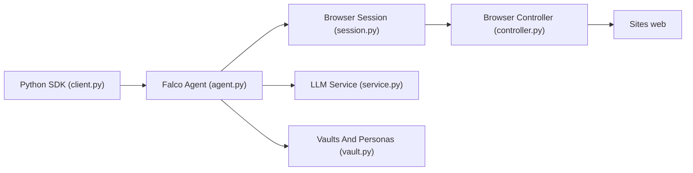

# nottelabs/notte

> Python framework for web agents mixing deterministic scripts and AI, to automate browsing.

## The problem
Purely LLM-driven browsing agents are expensive and unreliable; scripts alone break as soon as the page changes.

## What it actually does
A browser session (Playwright/patchright) is observed, an LLM picks the actions, a controller executes them. Structured output via Pydantic, scraping, and `AgentFallback`, which triggers an agent if a scripted step fails. Local mode is open source; the hosted API adds proxies, CAPTCHA solving, credential vaults and personas (email, phone, 2FA).

## How it is wired


## Trying it
```bash
pip install notte
patchright install --with-deps chromium
```
```python
import notte
with notte.Session(headless=False) as session:
    agent = notte.Agent(session=session, reasoning_model="gemini/gemini-3.5-flash", max_steps=10)
    response = agent.run(task="Find three cat memes on Google Images and describe them")
```

## Cost and gotchas
Local: your own LLM keys. Premium features (stealth, vault, personas): a Notte API key via the console. The benchmark table comes from the publisher itself.

## What it is not
It is not fully open source: the "recommended" offering is a hosted service. The vaults and personas are designed for creating accounts and bypassing anti-bot protections.

## Alternatives
- Browser-Use: cited in the benchmark as a direct competitor.
- Convergence: another web agent from the same table.

## For you
Keep an eye on it: interesting for hybrid web automation, but the license needs checking and the best features go through their cloud.
