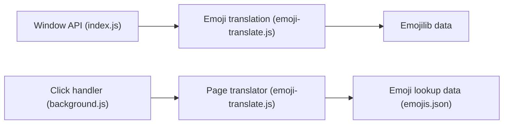

# notwaldorf/emoji-translate

> JavaScript library that replaces the words of a text with emojis, with a Chrome extension.

## The problem
An English text lacks emojis; the project is a game born at a hackday.

## What it actually does
- Five methods: `isMaybeAlreadyAnEmoji`, `getAllEmojiForWord`, `getEmojiForWord`, `translate`, `translateForDisplay`.
- Relies on emojilib (emoji names and keywords).
- A Chrome extension translates the texts of a web page.

## How it is wired


## Trying it
```bash
npm install moji-translate
```
```javascript
translate = require('moji-translate');
console.log(translate.translate("the house is on fire and the cat is eating the cake"));
```

## Cost and gotchas
Free. The npm package is called `moji-translate`, not `emoji-translate`. Last push in November 2021.

## What it is not
No semantic translation: simple word matching.

## Alternatives
No alternative named in the README.

## For you
Ignore: gimmick with no use for data/AI/MLOps and inactive since 2021.
