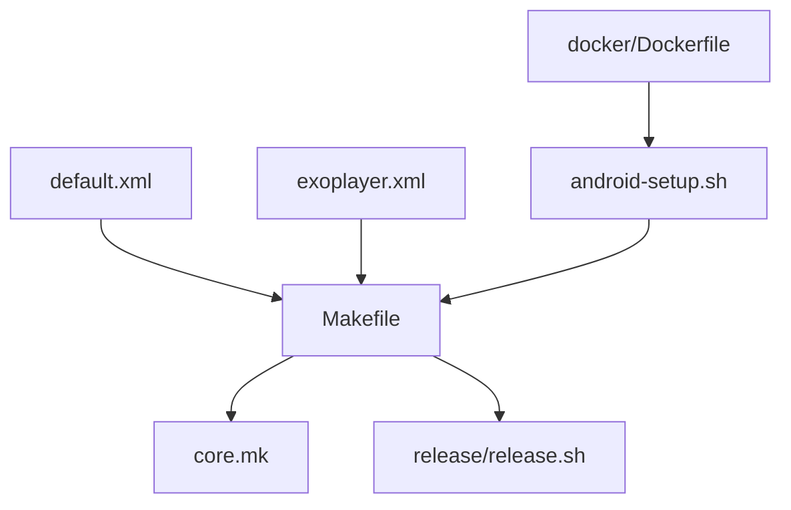

# nova-video-player/aos-AVP

> Build entry point for NOVA, a free Android video player derived from Archos Video Player.

## The problem
A free, maintained Android video player that supports new formats, after the original from Archos was abandoned.

## What it actually does
This repository contains only XML manifests that list the other repositories (Video interface, MediaLib, FileCoreLibrary, the `avos` C engine with ffmpeg). The Makefile and `core.mk` prepare the build, with an optional Dockerfile. `release` scripts produce the changelog and the publication. Metadata retrieval and watch tracking go through TMDb and Trakt, with keys you must supply.

## How it is wired


## Trying it
```bash
mkdir aos; cd aos
repo init -u https://github.com/nova-video-player/aos-AVP -b nova
repo sync -j4
repo forall -c 'git checkout -t $REPO_REMOTE/$REPO_RREV'
make
```

## Cost and gotchas
The `repo` tool, Android SDK and NDK, JDK 17 and 8. You must create TMDb and Trakt keys for scraping. Many open issues (980).

## What it is not
Not the player's code: the repository only assembles the sources. Not a desktop player.

## Alternatives
The original repository archos-sa/aos-AVP, of which NOVA is a fork.

## For you
Ignore: an Android player, unrelated to data or AI.
