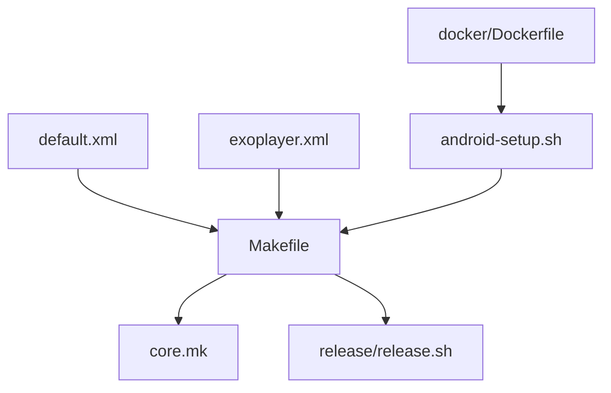

# nova-video-player/aos-AVP

> Point d'entrée de construction de NOVA, lecteur vidéo Android libre dérivé d'Archos Video Player.

## Le problème
Un lecteur vidéo Android libre, maintenu et prenant en charge de nouveaux formats, après l'abandon de l'original d'Archos.

## Ce que ça fait vraiment
Ce dépôt ne contient que des manifestes XML qui listent les autres dépôts (interface Video, MediaLib, FileCoreLibrary, moteur C `avos` avec ffmpeg). Le Makefile et `core.mk` préparent le build, avec un Dockerfile possible. Des scripts de `release` produisent changelog et publication. Récupération d'infos et suivi de visionnage passent par TMDb et Trakt, avec clés à fournir.

## Comment c'est branché


## Essayer
```bash
mkdir aos; cd aos
repo init -u https://github.com/nova-video-player/aos-AVP -b nova
repo sync -j4
repo forall -c 'git checkout -t $REPO_REMOTE/$REPO_RREV'
make
```

## Coût et pièges
Outil `repo`, SDK et NDK Android, JDK 17 et 8. Clés TMDb et Trakt à créer pour le scrapping. Beaucoup d'issues ouvertes (980).

## Ce que ce n'est pas
Pas le code du lecteur : le dépôt ne fait qu'assembler les sources. Pas un lecteur pour ordinateur.

## Alternatives
Le dépôt d'origine archos-sa/aos-AVP, dont NOVA est un fork.

## Pour toi
Ignorer : lecteur Android, sans lien avec la data ou l'IA.

