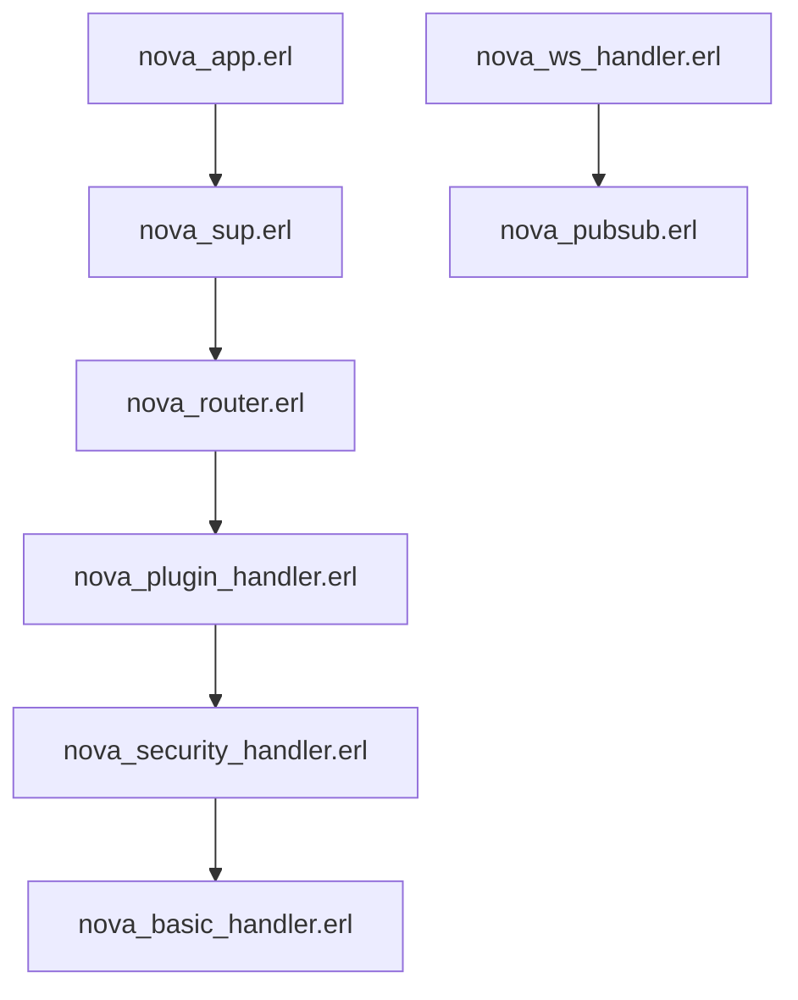

# novaframework/nova

> Web framework for the BEAM virtual machine, in Erlang, Elixir or LFE.

## The problem
Building fault-tolerant web applications on BEAM without assembling Cowboy and plugins by hand.

## What it actually does
Routing, controllers, ErlyDTL views, plugin pipeline (CORS, CSRF, correlation ID), WebSockets, Pub/Sub on `pg`, ETS sessions, per-route security, OpenTelemetry. A request goes through Cowboy, the Nova router, the plugins, security, then the controller.

## How it is wired


## Trying it
```bash
rebar3 new nova my_app
cd my_app
rebar3 nova serve
```

## Cost and gotchas
Erlang/OTP 23+ and Rebar3, `rebar3_nova` plugin to install. The Kura database layer is a separate package.

## What it is not
Not a Python or Node framework. Not a data tool: it serves web applications.

## Alternatives
No alternative named in the README.

## For you
Ignore: Erlang ecosystem, outside the usual data/AI/MLOps scope.
