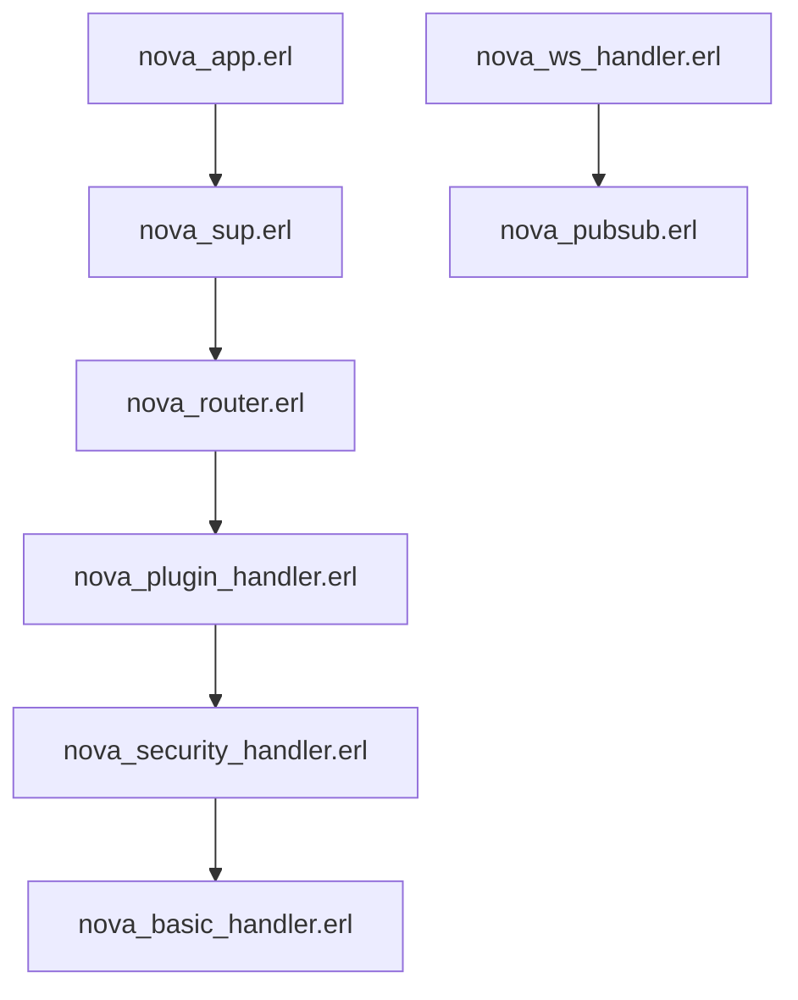

# novaframework/nova

> Framework web pour la machine virtuelle BEAM, en Erlang, Elixir ou LFE.

## Le problème
Construire des applications web tolérantes aux pannes sur BEAM sans assembler Cowboy et les plugins à la main.

## Ce que ça fait vraiment
Routage, contrôleurs, vues ErlyDTL, pipeline de plugins (CORS, CSRF, identifiant de corrélation), WebSockets, Pub/Sub sur `pg`, sessions ETS, sécurité par route, OpenTelemetry. Une requête passe par Cowboy, le routeur Nova, les plugins, la sécurité puis le contrôleur.

## Comment c'est branché


## Essayer
```bash
rebar3 new nova my_app
cd my_app
rebar3 nova serve
```

## Coût et pièges
Erlang/OTP 23+ et Rebar3, plugin `rebar3_nova` à installer. La couche base de données Kura est un paquet distinct.

## Ce que ce n'est pas
Pas un framework Python ni Node. Pas un outil de données : il sert des applications web.

## Alternatives
Aucune alternative nommée dans le README.

## Pour toi
Ignorer : écosystème Erlang, hors du périmètre data/IA/MLOps habituel.

