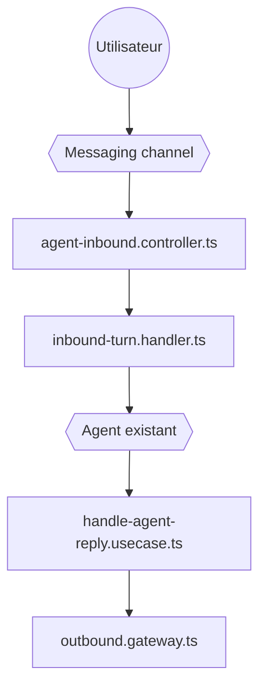

# novuhq/novu

> Multichannel notification infrastructure and conversation layer between AI agents and users.

## The problem
Each channel (email, SMS, push, Slack, Teams) has its own provider and webhooks; agents need to talk through them without rewrites.

## What it actually does
An API for sending notifications through dozens of providers, with workflows, digests, an Inbox component and preferences. An "agents" layer receives messages from a channel, normalizes them, routes them to your agent and sends its reply back.

## How it is wired


## Trying it
```bash
npx novu@latest connect
```
Otherwise: create a free account and follow the dashboard.

## Cost and gotchas
Getting started goes through a cloud account; providers (Twilio, SendGrid, etc.) are paid separately. License not identified by GitHub: check before self-hosting.

## What it is not
Not an agent: Novu carries the messages. No pricing is given in the README.

## Alternatives
No alternative named in the README.

## For you
Worth watching: useful for connecting an AI agent to Slack or email, but it depends on the cloud and the license needs reading.
